# Landmark Recognition Using the SIFT Algorithm

Lab 06, Computer Vision. A landmark recognition system built with Python and OpenCV. It extracts SIFT keypoints and descriptors from a database of reference images, matches them against a query image, decides which landmark is shown, and draws the landmark region on the query when the geometry checks out.

## Project Files

```
Lab06/Landmark-Recognition-SIFT/
├── Landmark_Recognition_SIFT.ipynb
├── README.md
└── assets/
    ├── fig_01_database_samples.png
    ├── fig_02_reference_keypoints.png
    ├── fig_03_query_keypoints.png
    ├── fig_04_ranking.png
    ├── fig_04_matches.png
    ├── fig_05_localization.png
    ├── fig_06_test_01.png ... fig_06_test_06.png
    ├── fig_07_performance_summary.png
    └── evaluation_results.csv
```

The notebook runs in Google Colab. Running it downloads the image database into `landmark_db/` and `unknown_query/` next to the notebook and saves every figure and the results table in the same folder.

## Parameters

| Parameter | Value |
|---|---|
| SIFT keypoint limit (`nfeatures`) | 3000 |
| SIFT `contrastThreshold` | 0.02 |
| Matcher | Brute-Force, Euclidean (L2) distance |
| k in kNN matching | 2 |
| Lowe's ratio | 0.75 |
| Minimum reliable matches | 15 |
| Minimum RANSAC inliers | 12 |
| Best candidate must lead the second by | 1.5 times |
| RANSAC reprojection threshold | 5.0 px |

The first trial used stricter limits (25 matches and 15 inliers). With those, correct matches were rejected by a very small margin, so the limits were relaxed to the values above.

## Task 1: Landmark Image Database

The reference images come from Wikimedia Commons, downloaded through its API in the notebook. Each landmark has 10 images, stored in its own folder under `landmark_db/<landmark name>/`:

| Landmark | Images | Used as reference | Held out for the viewpoint test |
|---|---|---|---|
| Eiffel Tower | 10 | 9 | 1 |
| Taj Mahal | 10 | 9 | 1 |
| Great Wall of China | 10 | 9 | 1 |
| Statue of Liberty | 10 | 9 | 1 |
| Colosseum | 10 | 9 | 1 |

One image of the Great Pyramid of Giza is stored in `unknown_query/`. This landmark is not in the database and is used to test rejection.

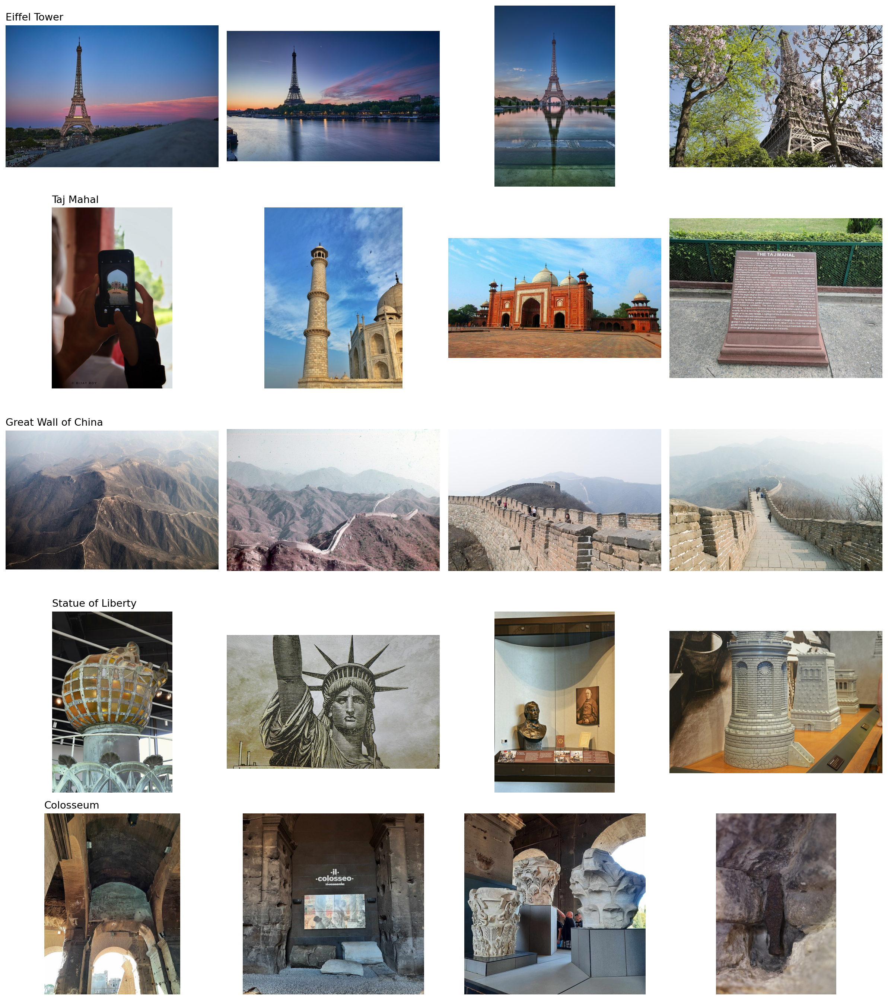

The images were filtered by file type, minimum width, aspect ratio and a list of unwanted title words. Some images still show close-ups or non-landmark views (see Limitations).

## Task 2: SIFT Feature Extraction

Each reference image is loaded, converted to grayscale, and processed with SIFT. Every keypoint gets a 128-dimensional descriptor. The descriptors are stored together with their landmark labels (`sift_descriptors.pkl`, created by the notebook).

Keypoints found in the first reference image of each landmark:

| Landmark | Keypoints |
|---|---|
| Eiffel Tower | 827 |
| Taj Mahal | 337 |
| Great Wall of China | 2435 |
| Statue of Liberty | 3001 |
| Colosseum | 3000 |

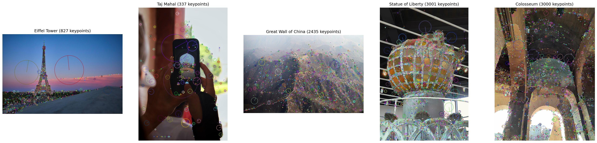

## Task 3: Query Image Processing

The query goes through the same steps: load, grayscale, SIFT keypoints, descriptors. The example below is an Eiffel Tower image rotated by 20 degrees. It produced 1100 keypoints with a descriptor array of 128 values per keypoint.

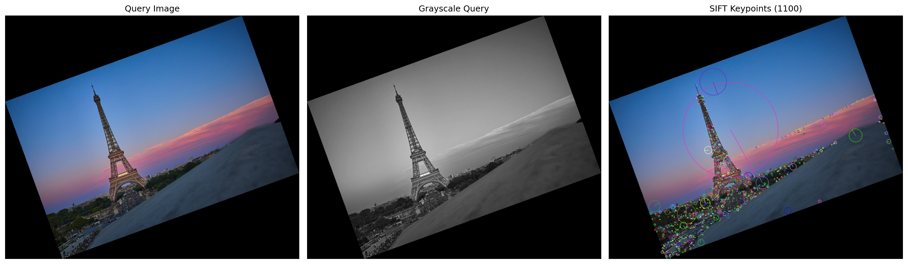

## Task 4: Feature Matching and Landmark Recognition

The query descriptors are compared with the descriptors of every reference image using the Brute-Force matcher (L2), kNN with k = 2, and Lowe's ratio test at 0.75. For each landmark the best single reference image gives its reliable match count, and the landmarks are ranked by that count.

For the example query, the Eiffel Tower got 566 reliable matches. Every other landmark stayed below 20.

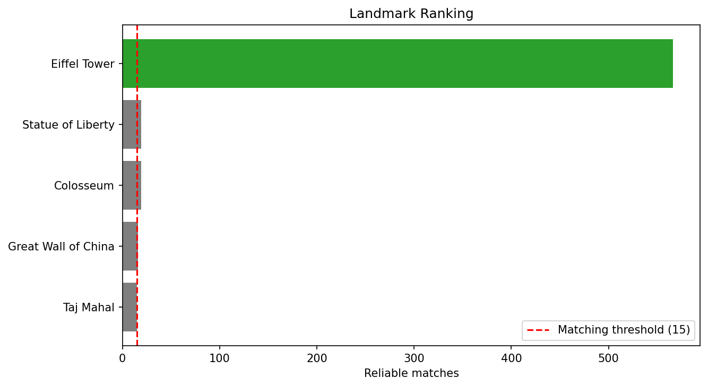

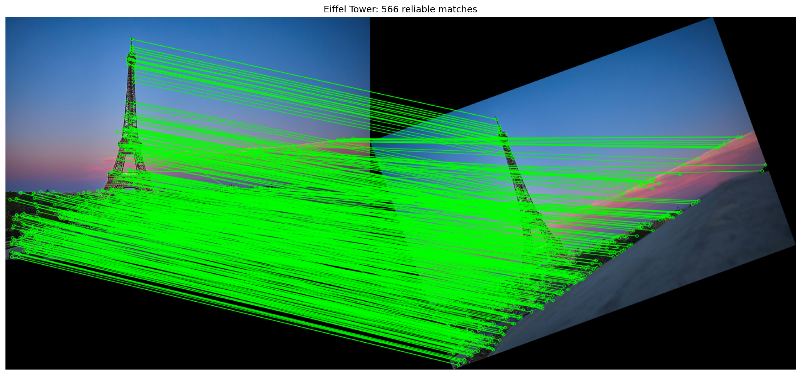

A large match count alone is not used to accept a query. A landmark is recognized only when all three conditions hold:

1. The best landmark has at least 15 reliable matches.
2. It has at least 1.5 times as many reliable matches as the second best landmark.
3. RANSAC finds at least 12 inliers and the projected polygon is valid.

Otherwise the query is rejected, and the message says which condition failed.

## Task 5: Landmark Localization

The reliable matches between the reference image and the query are used to estimate a homography with RANSAC. The four corners of the reference image are projected onto the query and drawn as a red polygon. If the transformation is unreliable (too few inliers, a non-convex shape, or an unreasonable area), no polygon is drawn and a message is shown.

For the example query: 566 reliable matches, 554 RANSAC inliers, status Recognized. The polygon follows the rotation of the query.

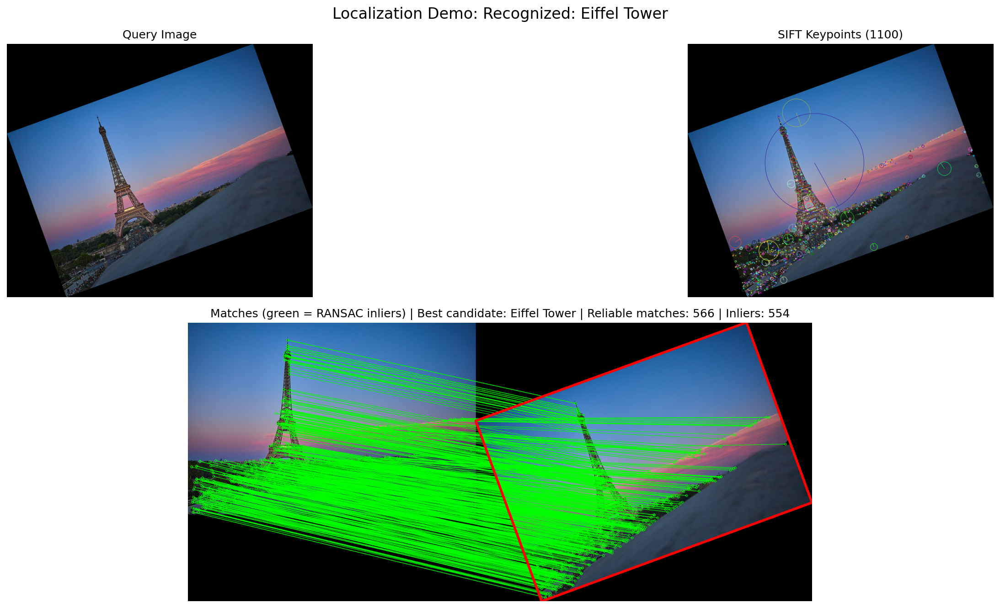

## Task 6: Performance Evaluation

Each landmark was tested under five conditions, plus one image of a landmark that is not in the database, giving 26 tests.

- **Original, rotated (45 degrees), resized (50%), reduced brightness:** made from an image that is in the reference database, so the original query is an exact copy of a reference image. These tests check how well SIFT handles rotation, scale and brightness change.
- **Different viewpoint:** a separate photo of the landmark that was kept out of the database. This is the real generalization test.
- **Unknown landmark:** the Great Pyramid of Giza image.

### Full results

| # | Test | Ground truth | Best candidate | Keypoints | Reliable matches | RANSAC inliers | Decision | Time (s) |
|---|---|---|---|---|---|---|---|---|
| 1 | Original | Eiffel Tower | Eiffel Tower | 827 | 827 | 827 | Recognized | 2.62 |
| 2 | Rotated (45 deg) | Eiffel Tower | Eiffel Tower | 1152 | 586 | 570 | Recognized | 3.71 |
| 3 | Resized (50%) | Eiffel Tower | Eiffel Tower | 237 | 164 | 162 | Recognized | 0.77 |
| 4 | Reduced brightness | Eiffel Tower | Eiffel Tower | 509 | 464 | 463 | Recognized | 1.73 |
| 5 | Different viewpoint | Eiffel Tower | Taj Mahal | 3000 | 17 | 5 | Rejected | 9.11 |
| 6 | Original | Taj Mahal | Taj Mahal | 337 | 337 | 337 | Recognized | 1.27 |
| 7 | Rotated (45 deg) | Taj Mahal | Taj Mahal | 393 | 210 | 201 | Recognized | 1.38 |
| 8 | Resized (50%) | Taj Mahal | Taj Mahal | 195 | 164 | 159 | Recognized | 0.61 |
| 9 | Reduced brightness | Taj Mahal | Taj Mahal | 199 | 185 | 185 | Recognized | 0.69 |
| 10 | Different viewpoint | Taj Mahal | Taj Mahal | 1927 | 156 | 105 | Recognized | 5.87 |
| 11 | Original | Great Wall of China | Great Wall of China | 2435 | 2435 | 2435 | Recognized | 7.39 |
| 12 | Rotated (45 deg) | Great Wall of China | Great Wall of China | 3000 | 1518 | 1512 | Recognized | 9.07 |
| 13 | Resized (50%) | Great Wall of China | Great Wall of China | 686 | 529 | 529 | Recognized | 2.13 |
| 14 | Reduced brightness | Great Wall of China | Great Wall of China | 401 | 364 | 364 | Recognized | 1.27 |
| 15 | Different viewpoint | Great Wall of China | Eiffel Tower | 2430 | 33 | 6 | Rejected | 7.29 |
| 16 | Original | Statue of Liberty | Statue of Liberty | 3001 | 3001 | 3001 | Recognized | 8.99 |
| 17 | Rotated (45 deg) | Statue of Liberty | Statue of Liberty | 3000 | 1688 | 1662 | Recognized | 9.14 |
| 18 | Resized (50%) | Statue of Liberty | Statue of Liberty | 1090 | 778 | 777 | Recognized | 3.32 |
| 19 | Reduced brightness | Statue of Liberty | Statue of Liberty | 2153 | 1972 | 1968 | Recognized | 6.52 |
| 20 | Different viewpoint | Statue of Liberty | Taj Mahal | 3000 | 15 | 5 | Rejected | 8.97 |
| 21 | Original | Colosseum | Colosseum | 3000 | 3000 | 3000 | Recognized | 9.03 |
| 22 | Rotated (45 deg) | Colosseum | Colosseum | 3000 | 1409 | 1376 | Recognized | 9.21 |
| 23 | Resized (50%) | Colosseum | Colosseum | 978 | 601 | 593 | Recognized | 2.96 |
| 24 | Reduced brightness | Colosseum | Colosseum | 1275 | 1153 | 1148 | Recognized | 3.93 |
| 25 | Different viewpoint | Colosseum | Great Wall of China | 3000 | 45 | 8 | Rejected | 8.97 |
| 26 | Landmark not in database | Unknown | Taj Mahal | 3000 | 33 | 5 | Rejected | 9.08 |

### Summary by condition

| Condition | Correct (of 5) | Avg reliable matches | Avg inliers | Avg time (s) |
|---|---|---|---|---|
| Original | 5 | 1920.0 | 1920.0 | 5.86 |
| Rotated (45 deg) | 5 | 1082.2 | 1064.2 | 6.50 |
| Resized (50%) | 5 | 447.2 | 444.0 | 1.96 |
| Reduced brightness | 5 | 827.6 | 825.6 | 2.83 |
| Different viewpoint | 1 | 53.2 | 25.8 | 8.04 |

- Known landmarks: 21 of 25 correct (84%).
- Unknown landmark: correctly rejected (33 matches but only 5 inliers).
- Overall: 22 of 26 decisions correct.
- Average processing time: 5.19 s per query, from 0.61 s to 9.21 s.

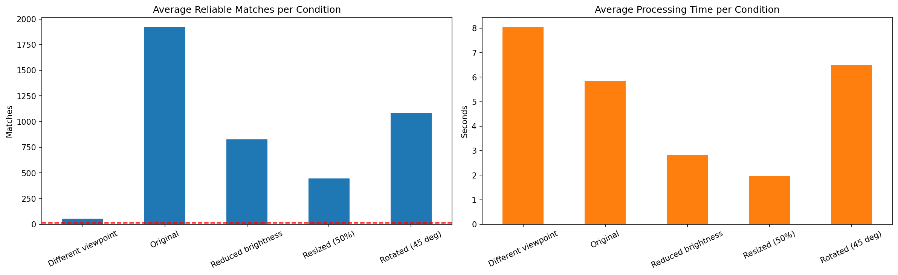

### Detailed outputs for the Eiffel Tower tests

**Original**

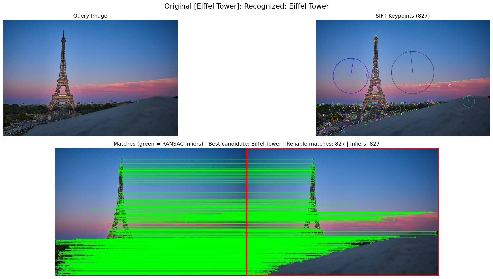

**Rotated (45 degrees)**

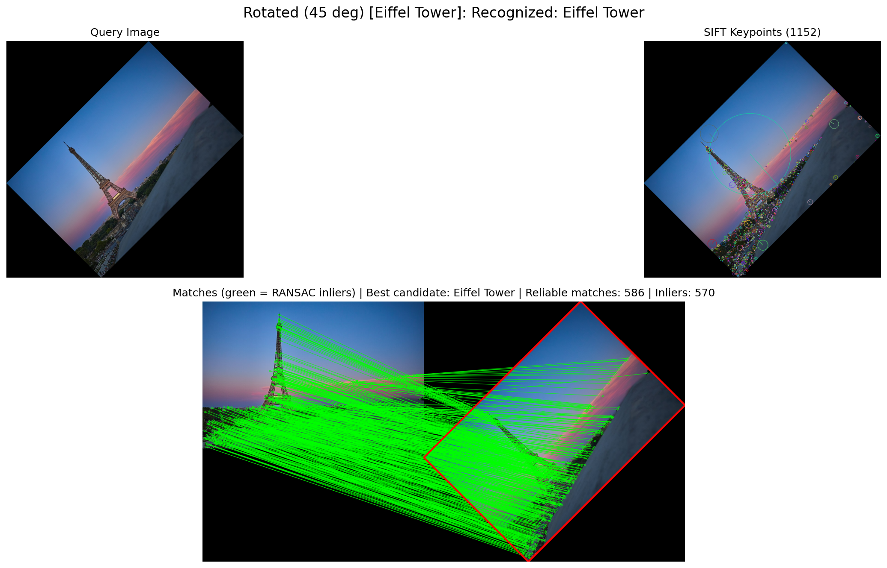

**Resized (50%)**

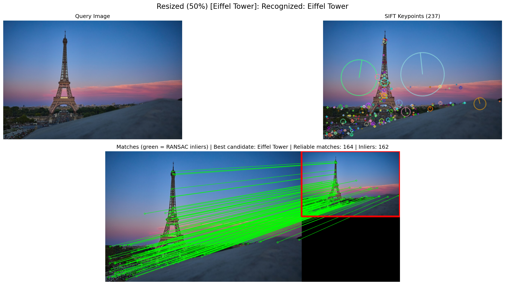

**Reduced brightness**

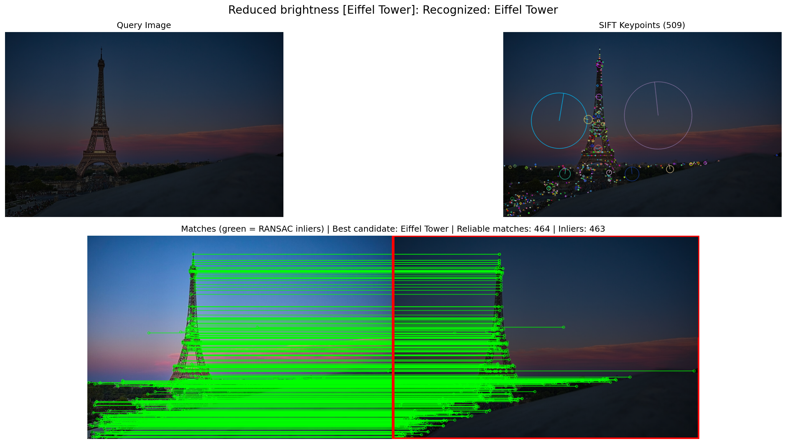

**Different viewpoint** (rejected: the best candidate was Taj Mahal with 17 matches and 5 inliers)

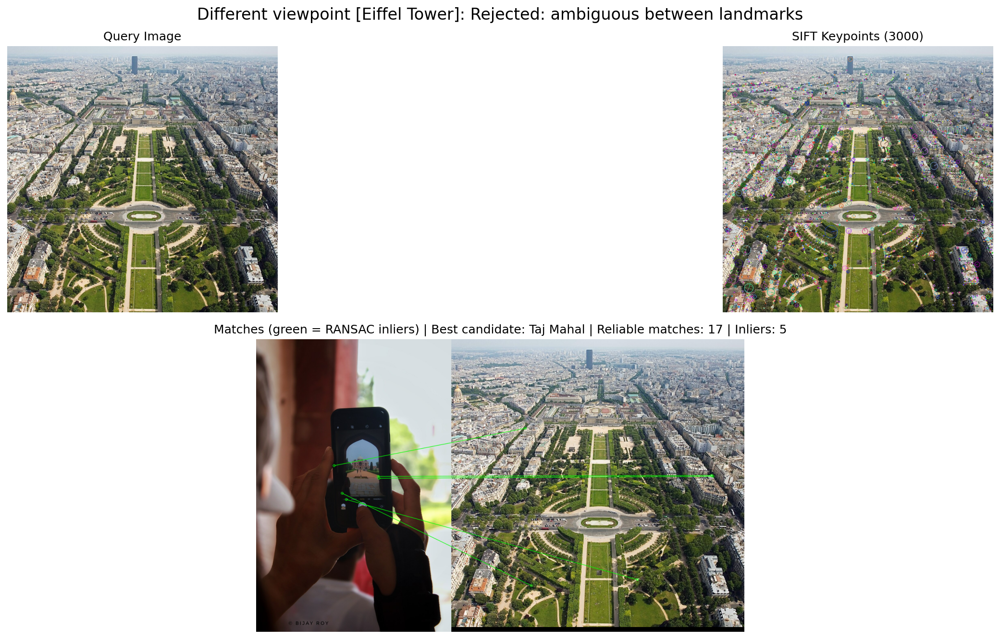

**Landmark not in database** (rejected: the best candidate was Taj Mahal with 33 matches and 5 inliers)

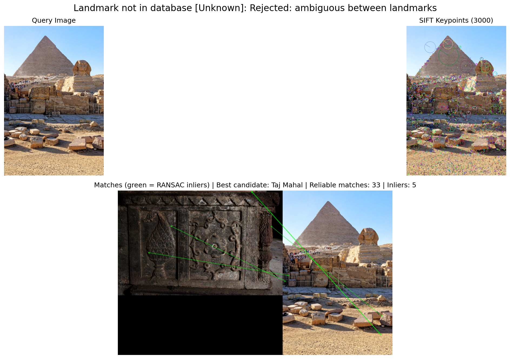

## Discussion

**Performance.** Every test made from a database image was recognized, including the 45 degree rotation, the 50% resize and the darkened image. Even the resized Eiffel Tower image, which had only 237 keypoints, gave 164 reliable matches and 162 inliers, and the polygon landed on the right region. This matches what SIFT is designed for: keypoints are found at different scales, descriptors are built relative to the dominant orientation, and gradient-based descriptors are mostly unaffected by brightness change.

**Rejection of wrong images.** The wrong candidates in the failed tests and in the unknown test never went above 8 inliers, while the correct recognitions never went below 105. The Great Pyramid image still got 33 reliable matches with the Taj Mahal images, which would have been a wrong prediction if only the match count was used. The inlier check removed it, which is why the geometric verification step matters.

**Different viewpoint.** Only 1 of 5 viewpoint queries was recognized (Taj Mahal, 156 matches and 105 inliers). The other four were rejected with 5 to 8 inliers. For the Eiffel Tower, the held-out image is an aerial view of the Champ de Mars where the tower itself is not visible, so no reference image can match it. For the other three landmarks the best candidate was a wrong landmark with only 5 to 8 inliers. SIFT handles scale and rotation well but not large changes in viewpoint, and the descriptors cannot match a view that looks different from every reference image.

**Processing time.** Queries with 2400 to 3000 keypoints took 7 to 9 seconds, while the resized images took 0.6 to 3.3 seconds. Brute-force matching compares every query descriptor with every descriptor in every reference image, so the time grows with the keypoint count and the size of the database.

## Limitations

- The reference database is small (9 images per landmark) and not carefully curated. In `fig_01` some images are not typical views of the landmark, such as a phone photo and an information plaque for the Taj Mahal, and a torch, an engraving, a bust and a museum model for the Statue of Liberty, and interior views for the Colosseum.
- The original, rotated, resized and brightness tests use images that exist in the database, so they show invariance to those changes, not recognition of new photos. The viewpoint test is the realistic one and it mostly failed.
- Each landmark has only one viewpoint test image, so the 20% viewpoint result rests on 5 images.
- The thresholds were adjusted after a first trial run.
- Matching is slow for images with many keypoints because the matcher is brute force. An approximate matcher such as FLANN would be faster.
- The polygon is the outline of the whole reference image projected onto the query, not a tight box around the landmark. It is large when the reference photo contains a lot of background.
- Only 5 landmarks and one unknown image were tested.

## Possible Improvements

- Build the database with more images per landmark, taken from different distances and angles, and remove close-ups and indoor shots by hand.
- Use more than one viewpoint test image per landmark.
- Use FLANN for faster matching.
