# Lab Assignment 03: Comparative Implementation of Machine Learning Regression Algorithms

**Name:** Osam Sami **Registration No:** FA23-BAI-056 **Program:** BS Artificial Intelligence, COMSATS University Islamabad, Wah Campus

---

## 1\. Objective

The goal of this assignment is to solve one regression problem with six different machine learning algorithms and compare them fairly. The problem is predicting the **price of a diamond** from its physical and quality characteristics.

The six algorithms are:

1. Linear Regression  
2. Decision Tree Regression  
3. Random Forest Regression  
4. Neural Network Regression  
5. XGBoost Regression  
6. K-Nearest Neighbors (KNN) Regression

Every algorithm is done in two ways:

- **Handwritten implementation:** working procedure, equations and a step-by-step calculation on a small sample of the dataset.  
- **Python implementation:** the same dataset, the same input features, the same target and the same 80:20 train/test split for all models.

All models are evaluated with MAE, MSE, RMSE and R² Score. The results are compared in a table and in charts, the strengths and limitations of each algorithm are discussed, and the best model is selected with a justification.

## 2\. Repository Contents

| File / Folder | Description |
| :---- | :---- |
| `Regression_Algorithms_Comparison.ipynb` | Complete notebook (EDA, preprocessing, all six models, comparison, discussion) with outputs |
| `assets/` | All 36 figures produced by the notebook and `comparison_results.csv` |
| `README.md` | This report |

## 3\. Dataset

**Dataset:** Diamonds dataset, loaded directly inside the notebook from this link:

```
https://raw.githubusercontent.com/mwaskom/seaborn-data/master/diamonds.csv
```

The dataset has **53,940 diamonds**, **9 input features** and one continuous target (`price`). It has no missing values.

| Feature | Type | Meaning |
| :---- | :---- | :---- |
| carat | numeric | weight of the diamond |
| cut | categorical (ordered) | cut quality: Fair \< Good \< Very Good \< Premium \< Ideal |
| color | categorical (ordered) | colour grade from J (worst) to D (best) |
| clarity | categorical (ordered) | clarity grade from I1 (worst) to IF (best) |
| depth | numeric | total depth percentage \= z / mean(x, y) |
| table | numeric | width of the top of the diamond relative to its widest point |
| x | numeric | length in mm |
| y | numeric | width in mm |
| z | numeric | depth in mm |
| **price** | **target** | price in US dollars (minimum 326, median 2,401, mean about 3,933, maximum 18,823) |

This dataset was chosen because it has many features, a mix of numeric and categorical columns, a large number of samples and a non-linear relationship between the features and the target. These properties make the difference between the algorithms easy to see.

## 4\. Exploratory Data Analysis

### 4.1 Target variable

The price is strongly right-skewed. Most diamonds are cheap and only a few are very expensive. After taking the logarithm the distribution becomes much less skewed.

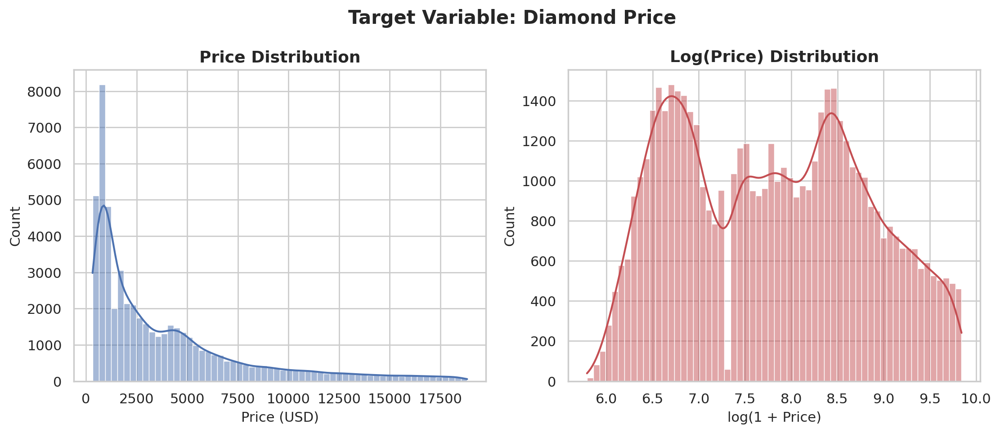

### 4.2 Numeric features

`carat` is right-skewed and has peaks at round values such as 0.3, 0.5, 1.0 and 1.5. `depth` is centred near 62\. The histograms of `y` and `z` show a few extreme values (y up to about 59 mm and z up to about 32 mm), which are measurement errors and are removed in preprocessing.

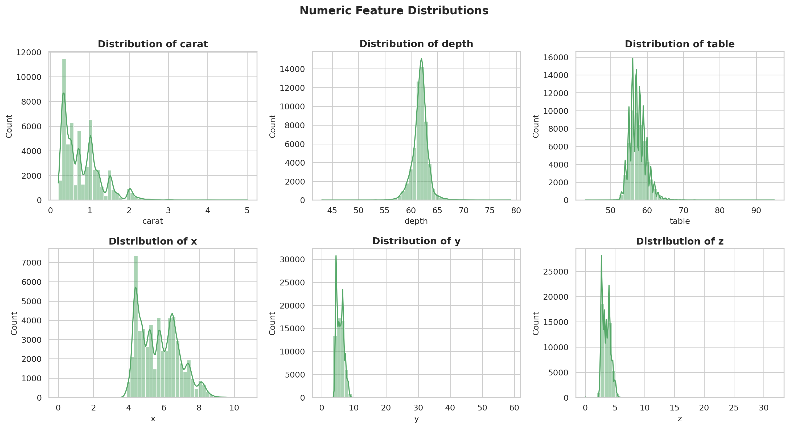

### 4.3 Categorical features

Most diamonds have an Ideal or Premium cut, and the middle colour and clarity grades are the most common.

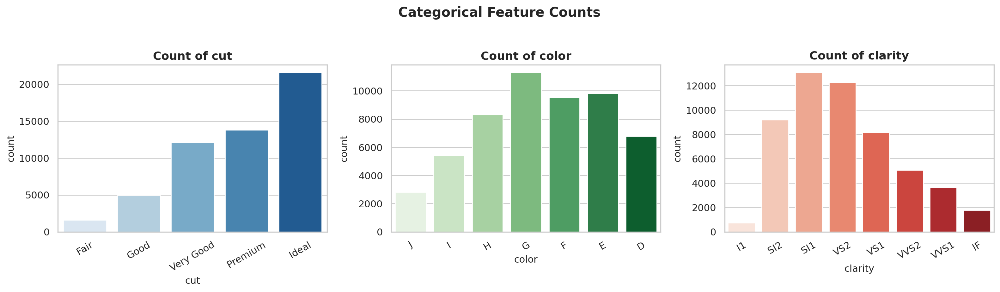

The boxplots show how price changes with each category. Interestingly, the best grades do not always have the highest prices, because diamonds with lower colour and clarity grades tend to be heavier, and weight is what drives the price most.

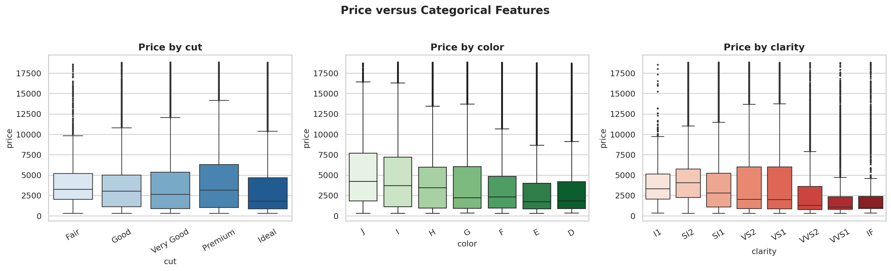

### 4.4 Price versus numeric features

Price grows with carat and with the physical size (x, y, z), and the growth is curved rather than a straight line. This already suggests that a purely linear model will not be enough.

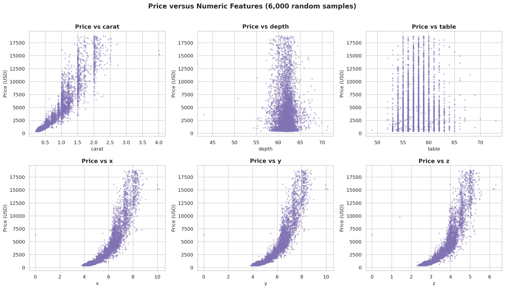

At the same carat weight, diamonds with better clarity are more expensive.

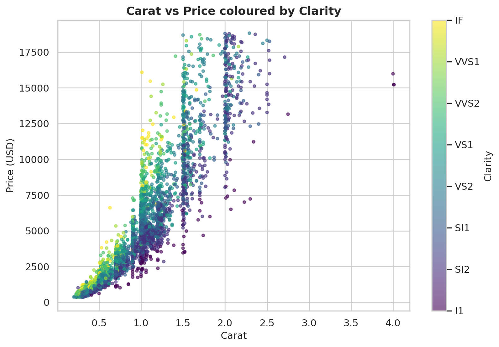

### 4.5 Correlation

`carat` has the strongest correlation with price (about 0.92), followed by x, y and z (about 0.88 to 0.89). Carat, x, y and z are also strongly correlated with each other, which causes multicollinearity for Linear Regression.

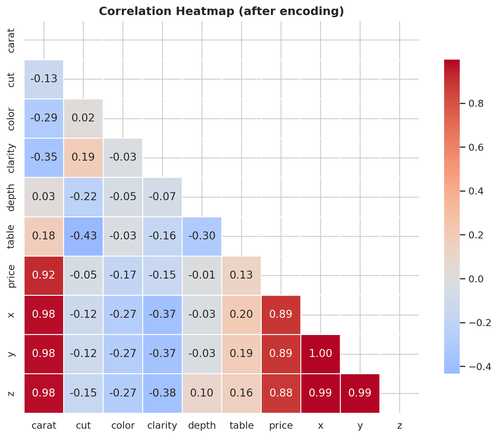

## 5\. Data Preprocessing

1. **Cleaning:** 20 rows with a zero dimension (x, y or z \= 0), rows with impossible sizes (y or z above 20 mm) and 146 duplicate rows were removed. The dataset went from 53,940 to **53,772 rows**.  
2. **Encoding:** `cut`, `color` and `clarity` have a natural order, so they were converted to integers with ordinal encoding that follows the quality order.  
3. **Train/test split:** 80% training and 20% testing (`random_state = 42`): **43,017 training samples** and **10,755 testing samples**. The same split is used for all six models.  
4. **Feature scaling:** StandardScaler (fitted on the training data only) is used for Linear Regression, KNN and the Neural Network, because these models are affected by the scale of the features. The Neural Network also uses a scaled target. Decision Tree, Random Forest and XGBoost use the unscaled data because trees are not affected by scaling.

The target distribution is almost identical in the training and test sets, so the split is representative.

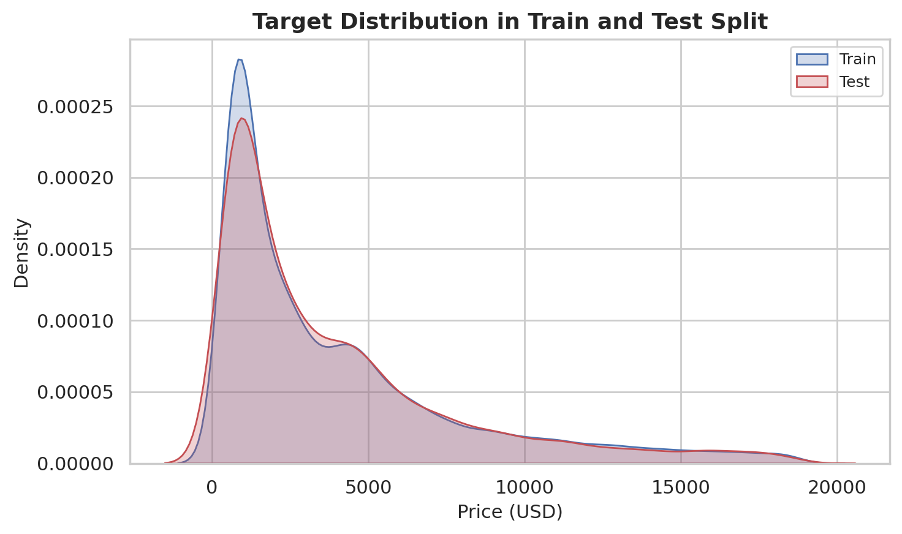

## 6\. Evaluation Metrics

Let yᵢ be the actual price, ŷᵢ the predicted price, ȳ the mean actual price and n the number of test samples.

| Metric | Formula | Meaning |
| :---- | :---- | :---- |
| MAE | (1/n) Σ \|yᵢ − ŷᵢ\| | average error in dollars |
| MSE | (1/n) Σ (yᵢ − ŷᵢ)² | average squared error |
| RMSE | √MSE | error in dollars, large errors are penalised more |
| R² | 1 − Σ(yᵢ − ŷᵢ)² / Σ(yᵢ − ȳ)² | share of the variance explained by the model (closer to 1 is better) |

## 7\. Handwritten Implementation

The handwritten solutions explain the working procedure and equations of each algorithm and solve it step by step on a small sample of the dataset (price in thousand USD, rounded):

| Row | carat | depth | price (k\$) |
| :---- | :---- | :---- | :---- |
| Train 1 | 0.3 | 62.0 | 0.6 |
| Train 2 | 0.5 | 61.6 | 1.4 |
| Train 3 | 0.7 | 61.6 | 2.8 |
| Train 4 | 0.9 | 62.7 | 4.1 |
| Train 5 | 1.2 | 62.8 | 7.2 |
| Test 1 | 0.8 | 62.2 | 2.8 |
| Test 2 | 1.0 | 62.3 | 5.8 |

What was calculated for each algorithm:

- **Linear Regression:** slope and intercept with the least squares formulas, then predictions for the test rows.  
- **Decision Tree:** SSE of every candidate split, choice of the best split at each level (depth 2), leaf means as predictions.  
- **Random Forest:** three bootstrap samples, one best-split stump on each, average of the three predictions.  
- **Neural Network:** forward pass of a 1-2-1 network with ReLU, squared error loss, back-propagation and one gradient descent update.  
- **XGBoost:** gradients and hessians, split gain, leaf weights and two boosting rounds with learning rate 0.5.  
- **KNN:** min-max scaling of carat and depth, Euclidean distances to all training rows, average of the 3 nearest neighbours.

Result of the handwritten sample on the 2 test rows (all values are verified with NumPy in the appendix of the notebook):

| Algorithm | MAE | MSE | RMSE | R² |
| :---- | :---- | :---- | :---- | :---- |
| Linear Regression | 0.7668 | 0.6455 | 0.8034 | 0.7131 |
| Decision Tree | 1.5000 | 2.9725 | 1.7241 | \-0.3211 |
| Random Forest | 0.6444 | 0.4413 | 0.6643 | 0.8039 |
| Neural Network (one update step) | 2.4656 | 7.8627 | 2.8040 | \-2.4945 |
| XGBoost (two rounds) | 1.2755 | 2.2530 | 1.5010 | \-0.0013 |
| KNN (K \= 3\) | 0.7000 | 0.6500 | 0.8062 | 0.7111 |

These numbers only show the working of the algorithms on 5 training points. The Neural Network got a single update step and XGBoost only two rounds, so their handwritten errors are large. The real comparison is the Python experiment below, which uses the full dataset.

## 8\. Linear Regression

**Working:** the price is modelled as a weighted sum of the features, ŷ \= β₀ \+ β₁x₁ \+ … \+ β₉x₉. The weights minimise the sum of squared errors and have the closed-form solution β \= (XᵀX)⁻¹Xᵀy. The features are standardised, so the coefficients can be compared directly.

**Result:** MAE 797.91, RMSE 1,215.80, R² 0.9048.

The strongest positive coefficients are carat (about \+5,276), y (about \+2,510), clarity (about \+818) and color (about \+555). The coefficients of x and z are negative (about \-2,142 and \-1,515) even though both are positively correlated with price. This happens because carat, x, y and z carry almost the same information (multicollinearity).

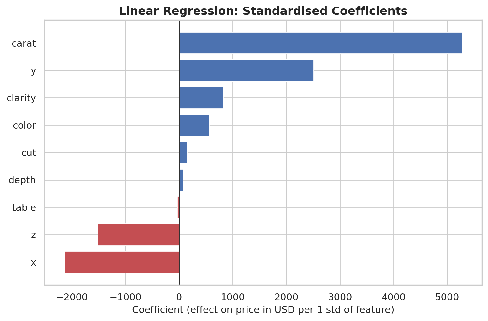

The model cannot follow the curved relationship between size and price. It under-predicts expensive diamonds and for cheap diamonds it even predicts negative prices: 888 of the 10,755 test predictions are negative (the lowest is about \-2,548 USD).

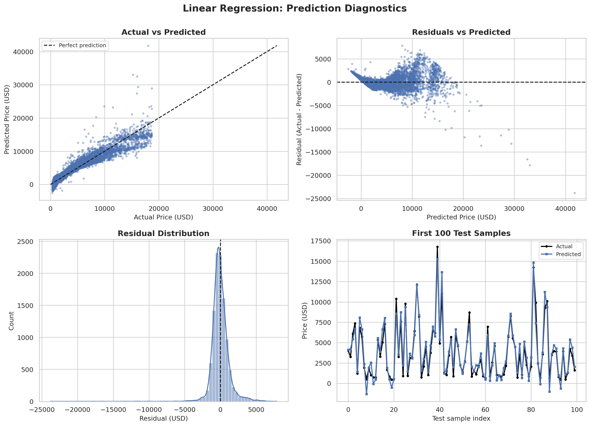

## 9\. Decision Tree Regression

**Working:** the data is split again and again with yes/no questions on one feature. At each node the split with the smallest total SSE is chosen, and the prediction is the mean price of the leaf: Gain \= SSE(parent) − \[SSE(left) \+ SSE(right)\].

**Tuning:** an unrestricted tree memorises the training data, so `max_depth` was selected with 3-fold cross-validation on the training set only. The best depth was **10**.

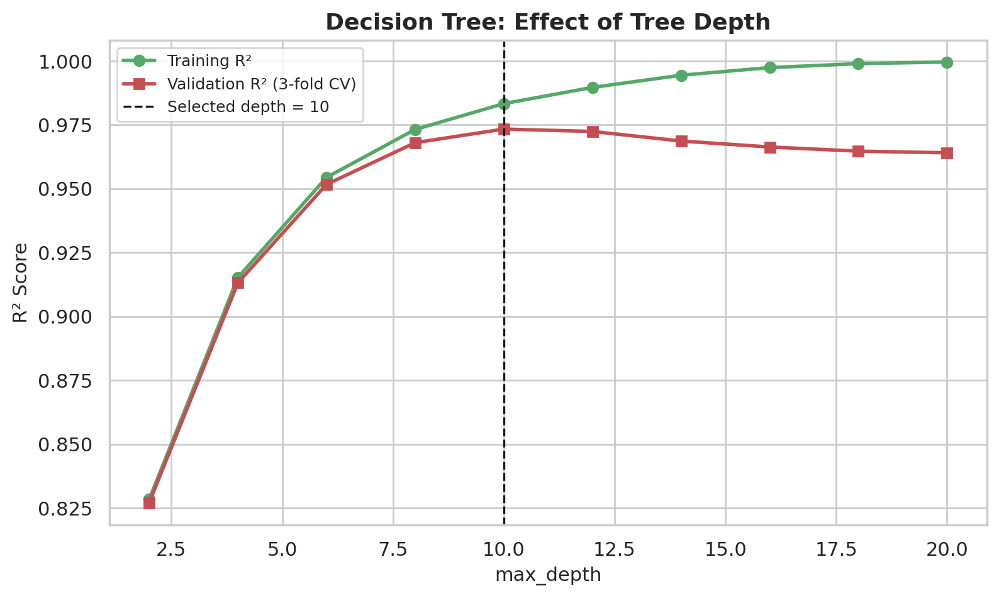

**Result:** MAE 332.63, RMSE 615.93, R² 0.9756 (training R² 0.9823).

The top levels of the tree split mostly on carat and y.

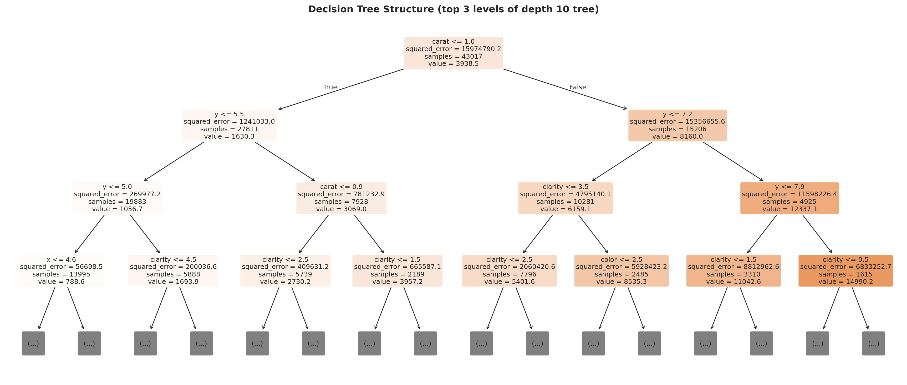

Feature importance: carat (about 0.64) and y (about 0.26) account for almost all the importance, followed by clarity (about 0.06) and color (about 0.03).

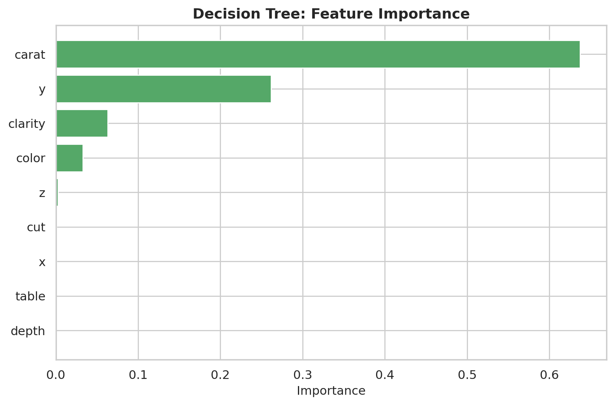

The predictions lie in horizontal bands because a tree predicts one constant value per leaf.

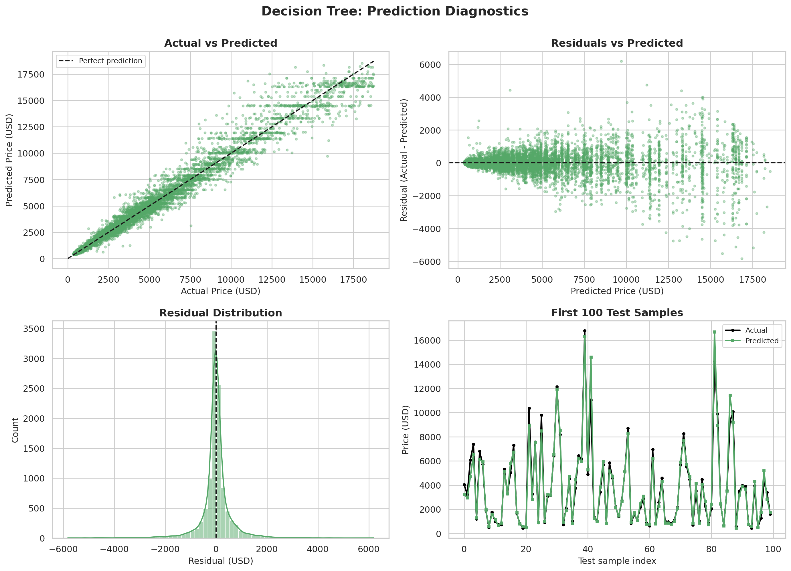

## 10\. Random Forest Regression

**Working:** many trees are trained on different bootstrap samples of the data and each split looks at a random subset of the features. The final prediction is the average of all trees, ŷ \= (1/T) Σ fₜ(x). Averaging removes most of the variance of a single tree.

**Settings:** 200 trees, `max_features = 0.6`, fully grown trees.

**Result:** MAE 263.03, RMSE 518.80, R² 0.9827 (training R² 0.9975). It has the lowest MAE of all models.

The test R² improves quickly up to about 50 trees and then stays almost flat, so 200 trees are more than enough.

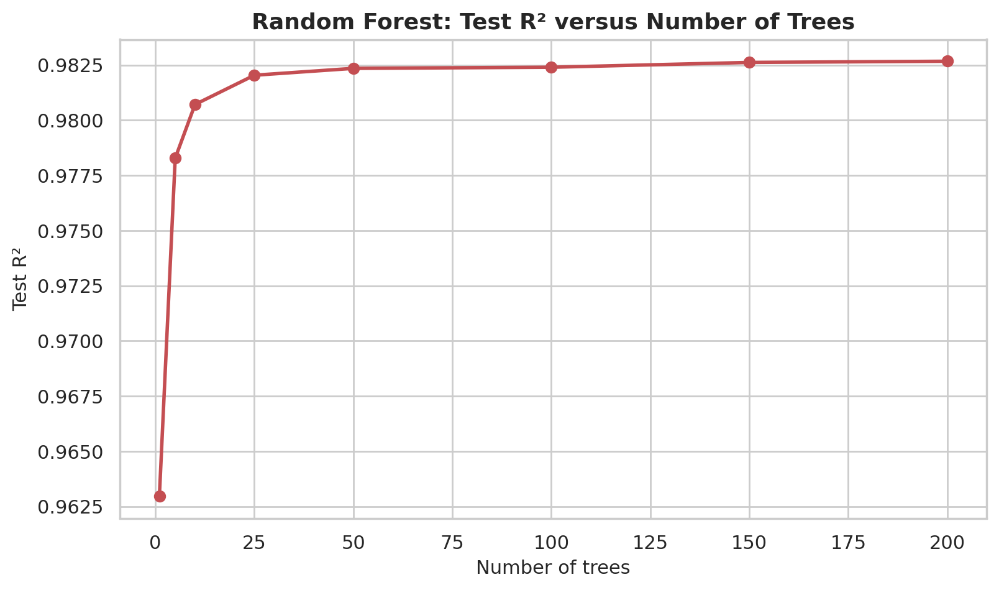

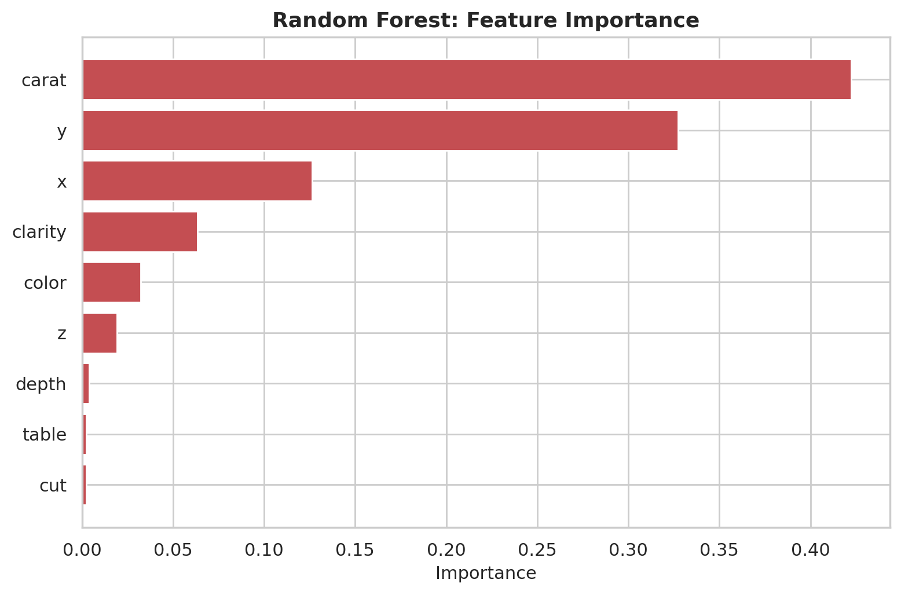

The scatter plot is much tighter around the perfect prediction line than for the single tree.

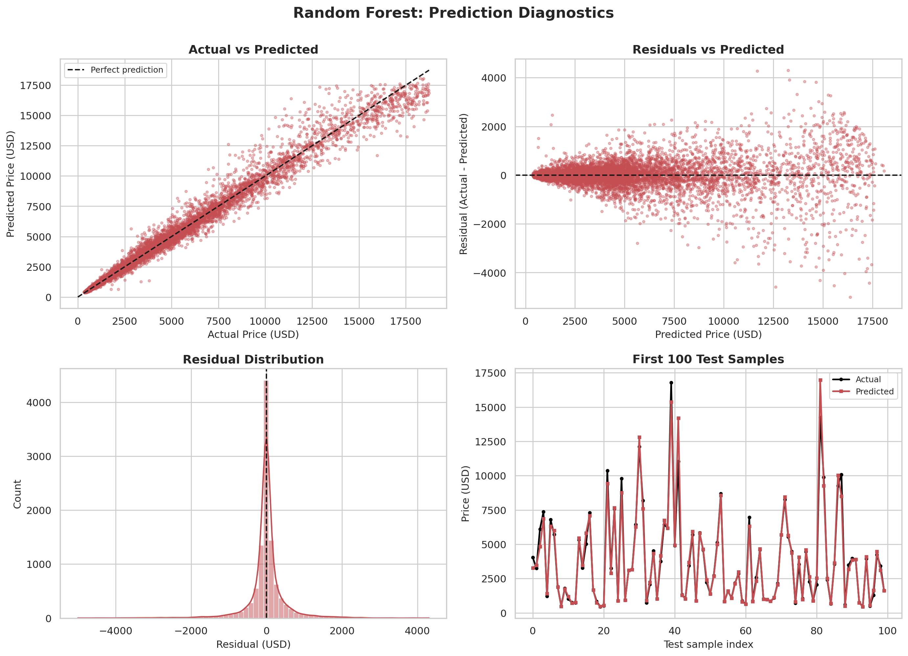

## 11\. Neural Network Regression

**Working:** a multi-layer perceptron. Every layer computes a \= ReLU(W·x \+ b) and the output layer is linear. The loss is the mean squared error and the weights are learned with back-propagation and the Adam optimiser.

**Architecture:** 9 inputs, then hidden layers of 128, 64 and 32 neurons with ReLU, then 1 output neuron. Batch size 256, learning rate 0.001, early stopping on a 10% validation part of the training data. Training stopped after **46 epochs**. The inputs and the target price are standardised, and the predictions are converted back to dollars.

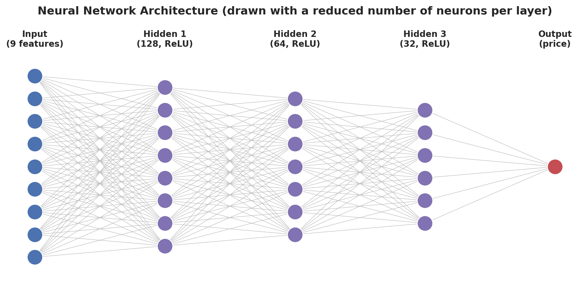

**Result:** MAE 289.44, RMSE 531.88, R² 0.9818 (training R² 0.9831). The training and test R² are almost the same, so this model overfits the least.

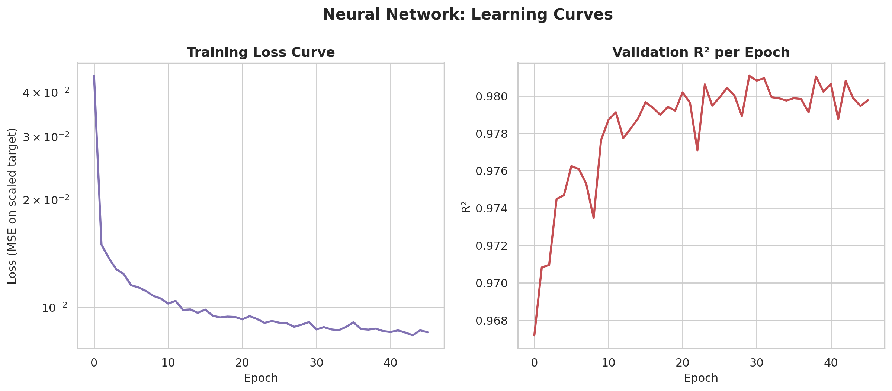

The predictions are smooth and do not show the banding of the tree.

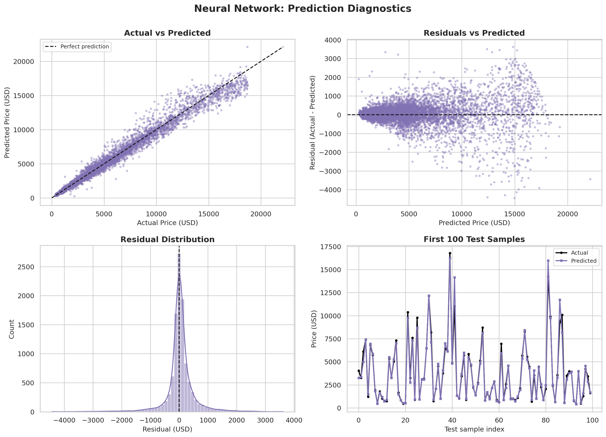

## 12\. XGBoost Regression

**Working:** gradient boosting. Trees are built one after another and every new tree corrects the errors of the previous ones: ŷ⁽ᵗ⁾ \= ŷ⁽ᵗ⁻¹⁾ \+ η·fₜ(x). With squared error, the gradient is gᵢ \= ŷᵢ − yᵢ and the hessian is hᵢ \= 1\. The optimal leaf weight is w \= −Σg / (Σh \+ λ).

**Settings:** 600 boosting rounds, learning rate 0.05, `max_depth = 6`, `subsample = 0.8`, `colsample_bytree = 0.8`, `reg_lambda = 1`.

**Result:** MAE 268.39, RMSE 515.06, R² 0.9829 (training R² 0.9917). This is the best RMSE and the best R² of all six models.

The test RMSE drops steeply in the first 100 rounds and is almost flat after about 150 rounds, while the training RMSE keeps decreasing slowly. This growing gap between the two curves is the mild overfitting seen in the train and test R² values.

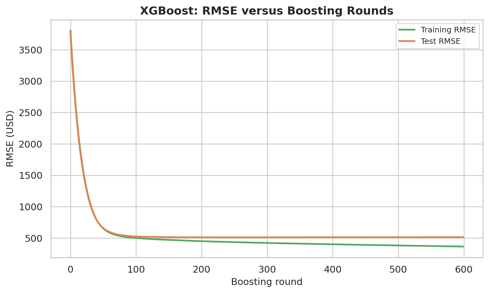

XGBoost gives the most importance to y (about 0.60) and carat (about 0.26).

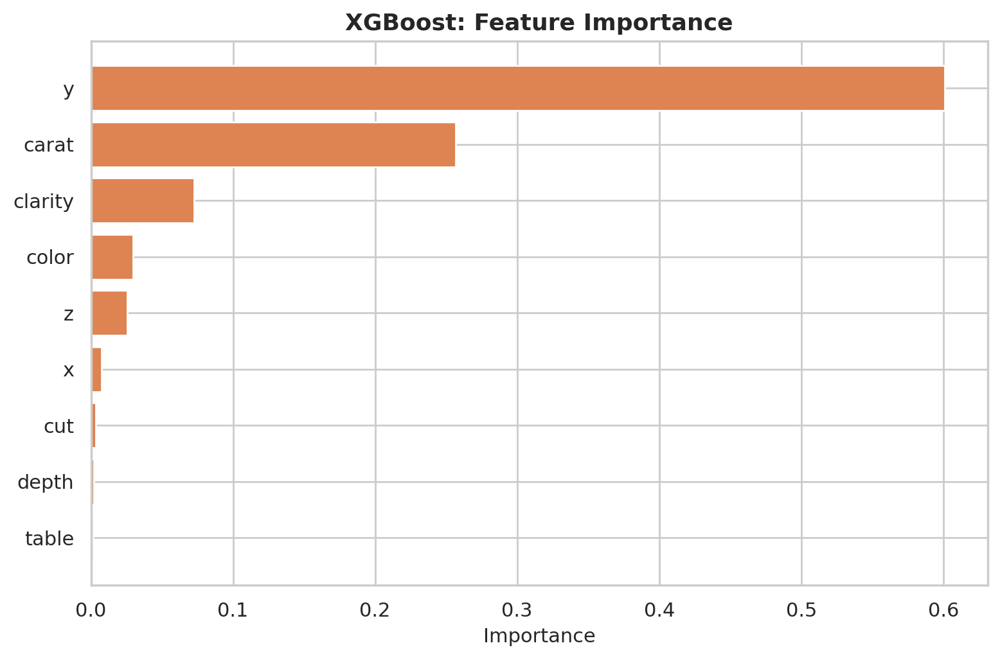

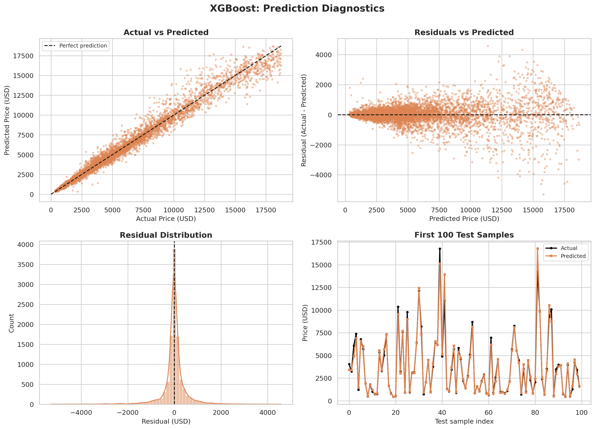

## 13\. K-Nearest Neighbors Regression

**Working:** to predict a new diamond, the K most similar training diamonds are found with the Euclidean distance d(a, b) \= √Σ(aⱼ − bⱼ)², and their prices are averaged. Nothing is learned during training. Scaled features are essential, otherwise the features with large ranges would dominate the distance.

**Tuning:** K was chosen with 3-fold cross-validation on the training set (K from 1 to 31). The best value was **K \= 9**.

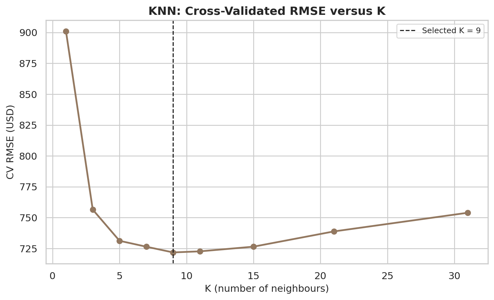

**Result:** MAE 374.72, RMSE 702.80, R² 0.9682 (training R² 0.9755).

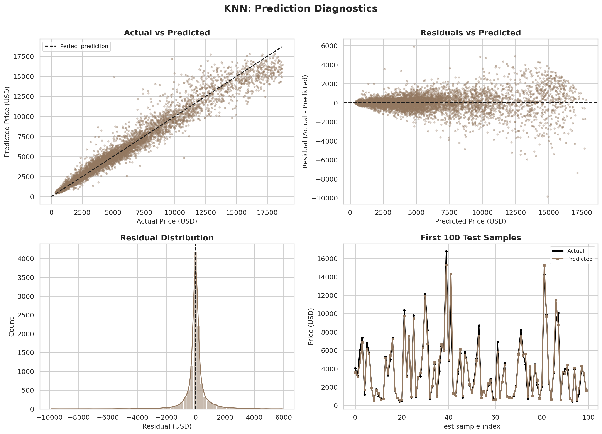

## 14\. Comparative Performance of All Models

All values are on the same 10,755 test samples.

| Model | MAE | MSE | RMSE | R² Score |
| :---- | :---- | :---- | :---- | :---- |
| Linear Regression | 797.91 | 1,478,170 | 1,215.80 | 0.9048 |
| Decision Tree | 332.63 | 379,366 | 615.93 | 0.9756 |
| Random Forest | **263.03** | 269,150 | 518.80 | 0.9827 |
| Neural Network | 289.44 | 282,899 | 531.88 | 0.9818 |
| **XGBoost** | 268.39 | **265,282** | **515.06** | **0.9829** |
| KNN | 374.72 | 493,922 | 702.80 | 0.9682 |

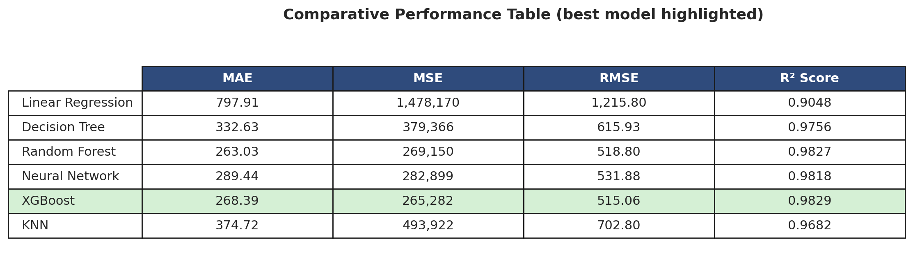

### 14.1 Metric comparison

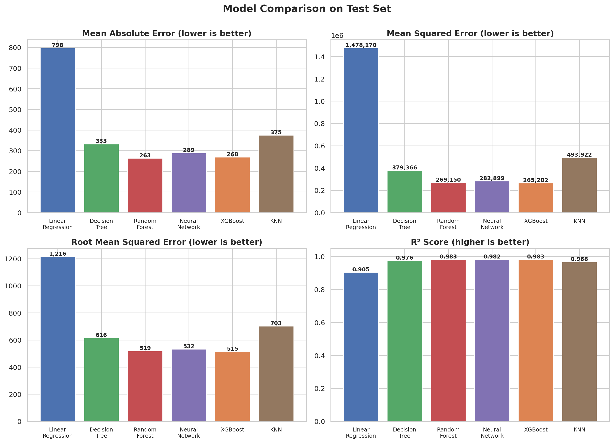

### 14.2 Ranking across the four metrics

| Model | MAE rank | MSE rank | RMSE rank | R² rank | Average rank |
| :---- | :---- | :---- | :---- | :---- | :---- |
| XGBoost | 2 | 1 | 1 | 1 | **1.25** |
| Random Forest | 1 | 2 | 2 | 2 | 1.75 |
| Neural Network | 3 | 3 | 3 | 3 | 3.00 |
| Decision Tree | 4 | 4 | 4 | 4 | 4.00 |
| KNN | 5 | 5 | 5 | 5 | 5.00 |
| Linear Regression | 6 | 6 | 6 | 6 | 6.00 |

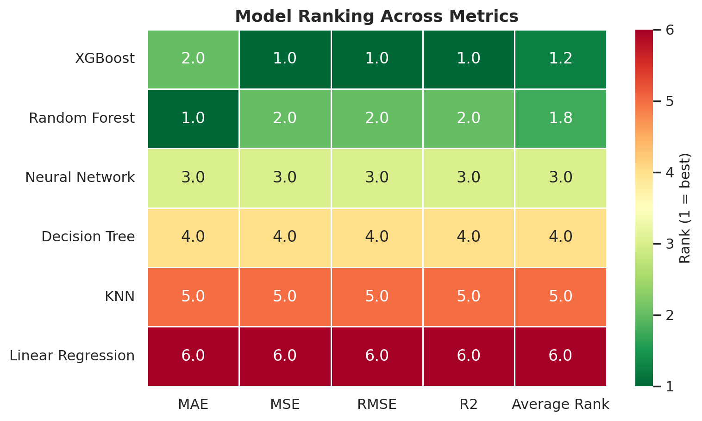

## 15\. Visual Comparison: Actual versus Predicted

The dashed line is the perfect prediction. The closer the points are to it, the better the model. Linear Regression is the most scattered and bends away from the line for expensive diamonds. Decision Tree shows horizontal bands. Random Forest, Neural Network and XGBoost are the tightest.

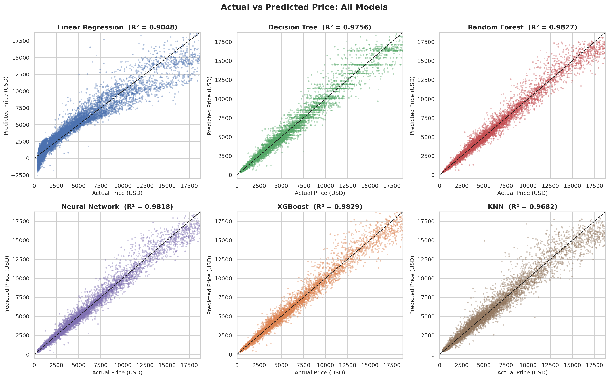

The first 80 test samples as lines (black is the actual price):

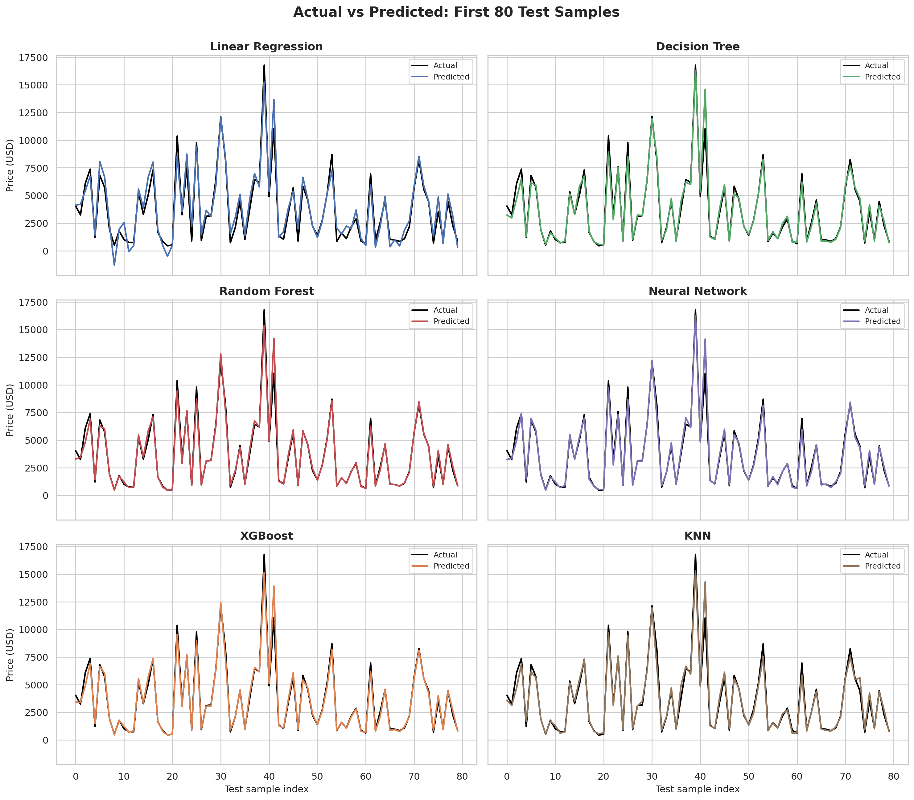

All test samples arranged from the cheapest to the most expensive diamond:

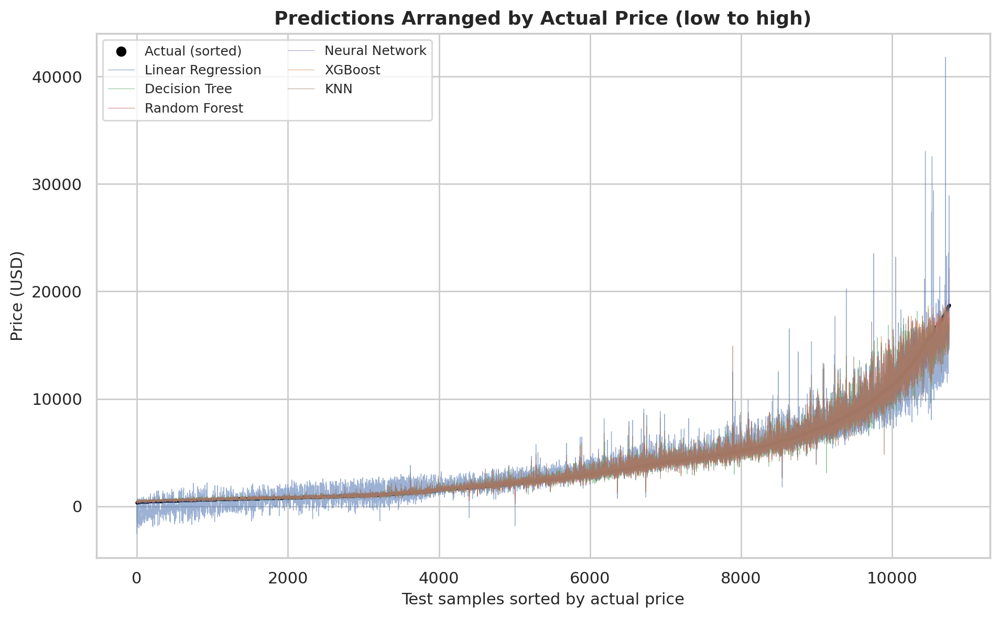

## 16\. Error Analysis

**Residual distribution.** The residuals of the three best models are narrow and centred near zero. Linear Regression has a much wider spread.

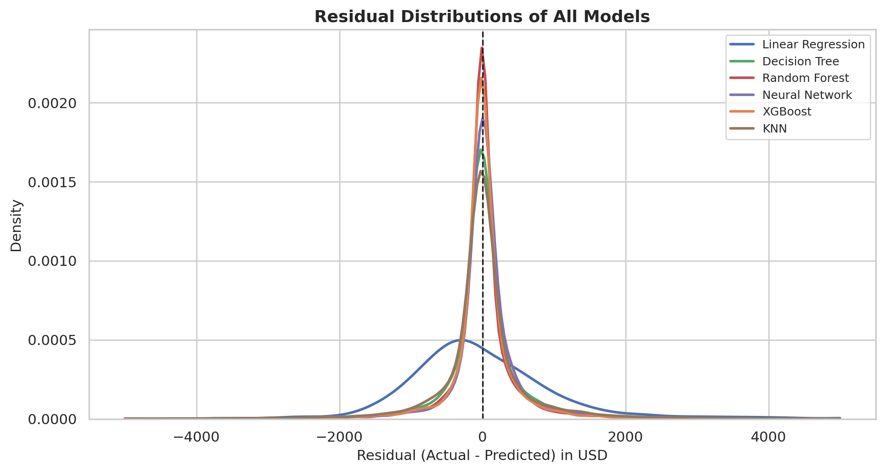

**Absolute errors (log scale).** The median error of the ensemble and neural models is far lower than that of Linear Regression and KNN.

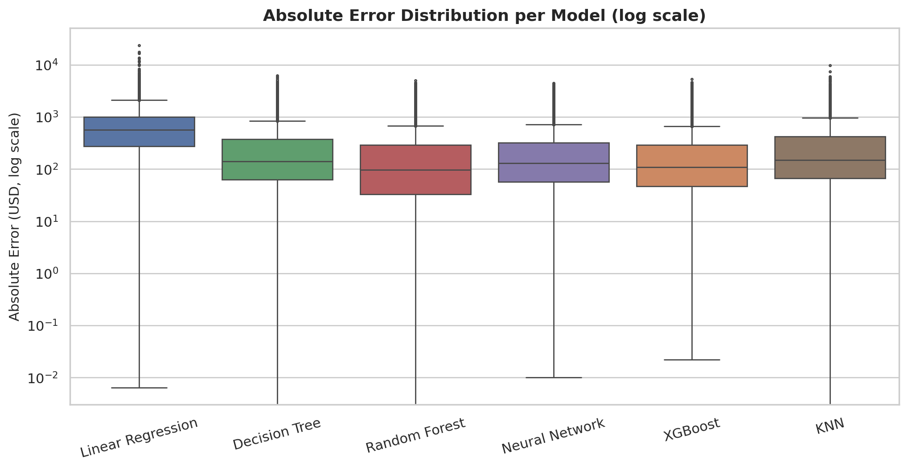

**Error by price range.** All models make larger errors on expensive diamonds. There are fewer expensive diamonds to learn from and their prices vary more.

| Price range (USD) | Linear Regression | Decision Tree | Random Forest | Neural Network | XGBoost | KNN |
| :---- | :---- | :---- | :---- | :---- | :---- | :---- |
| below 1k | 652.0 | 79.9 | 40.7 | 70.6 | 60.2 | 82.8 |
| 1k to 2.5k | 525.9 | 142.2 | 103.9 | 133.5 | 113.3 | 164.0 |
| 2.5k to 5k | 613.0 | 330.7 | 262.3 | 274.6 | 262.6 | 360.0 |
| 5k to 10k | 904.9 | 591.7 | 473.4 | 495.8 | 466.2 | 651.8 |
| above 10k | 2,175.1 | 1,077.7 | 929.2 | 978.5 | 918.6 | 1,285.2 |

The table shows the MAE in USD. Random Forest is best for the cheapest diamonds and XGBoost is best in the higher price ranges.

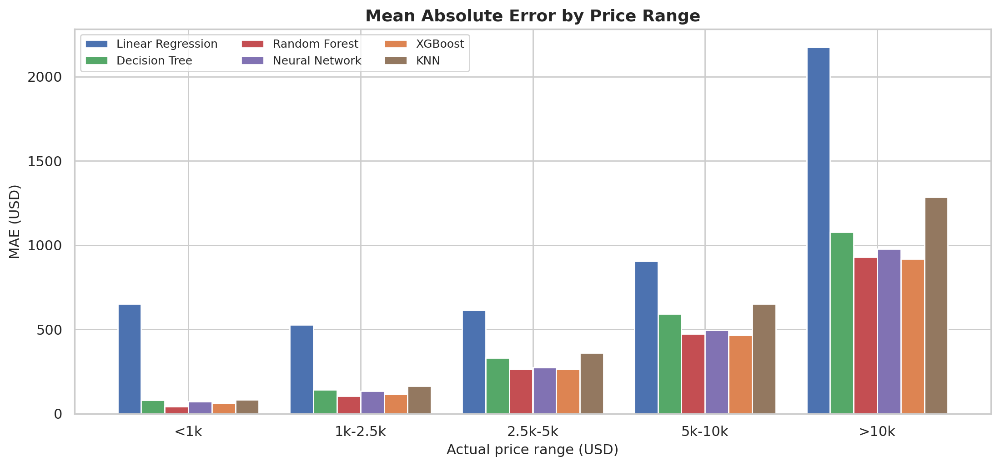

## 17\. Overfitting and Training Time

| Model | Train R² | Test R² | Gap | Training time (s) |
| :---- | :---- | :---- | :---- | :---- |
| Linear Regression | 0.9089 | 0.9048 | 0.0041 | 0.03 |
| Decision Tree | 0.9823 | 0.9756 | 0.0067 | 0.19 |
| Random Forest | 0.9975 | 0.9827 | 0.0148 | 29.49 |
| Neural Network | 0.9831 | 0.9818 | 0.0013 | 26.55 |
| XGBoost | 0.9917 | 0.9829 | 0.0088 | 7.82 |
| KNN | 0.9755 | 0.9682 | 0.0073 | 0.07 |

Linear Regression has a small gap only because it is too simple (it underfits). Random Forest has the largest gap between training and test R², and the Neural Network has the smallest. XGBoost reaches the best test score with a smaller gap than Random Forest and in about a quarter of the training time. The training times were measured on Google Colab and will differ slightly on other machines.

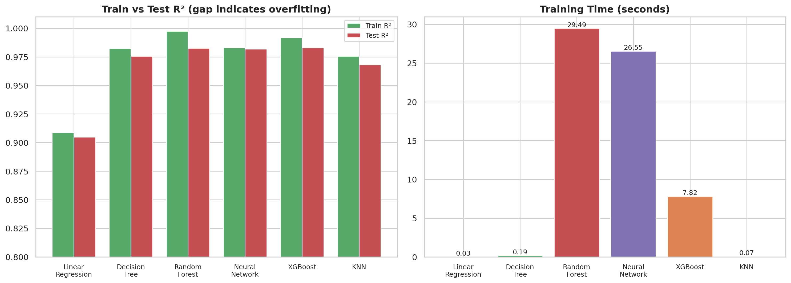

## 18\. Feature Importance Across the Tree-Based Models

Carat and y are the most important features in all three models. Random Forest also uses x, which the other two hardly use, because it considers a random subset of features at every split. Cut, depth and table have almost no influence on the predicted price.

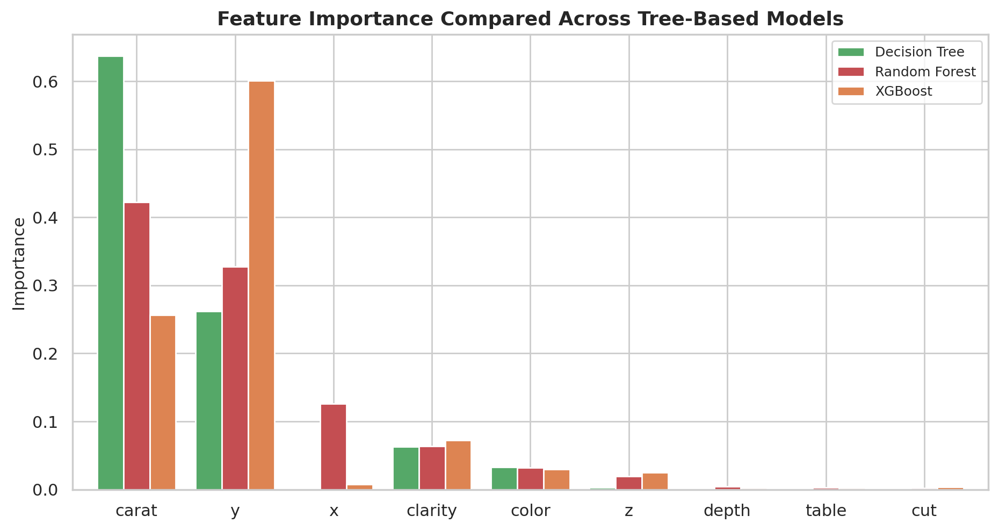

## 19\. Strengths and Limitations of Each Algorithm

| Algorithm | Strengths | Limitations |
| :---- | :---- | :---- |
| Linear Regression | Very fast, simple, coefficients are easy to interpret, a good baseline | Only models straight-line relationships, predicted negative prices, affected by correlated features (carat, x, y, z) and outliers |
| Decision Tree | Captures non-linear patterns and interactions, no scaling needed, easy to visualise | Overfits when deep, unstable, step-like predictions |
| Random Forest | Averaging many trees removes most of the variance, robust, gives feature importance, lowest MAE | Largest train-test gap, slow to train, uses more memory, hard to interpret, cannot predict outside the range of the training prices |
| Neural Network | Learns smooth complex patterns, very small train-test gap, very good accuracy | Needs scaled inputs and target, many hyper-parameters, slow to train, results depend on the random seed, acts as a black box |
| XGBoost | Corrects its own errors round by round, built-in regularisation, best RMSE and R², faster than Random Forest | Several hyper-parameters to tune, can overfit with too many rounds, harder to interpret than one tree |
| KNN | Simple idea, no training step, naturally non-linear | Needs scaled features, slow predictions on large data, sensitive to K and to irrelevant features |

## 20\. Best Performing Algorithm

**XGBoost Regression is the best model in this experiment.**

Justification:

1. It has the lowest MSE (265,282) and RMSE (515.06) and the highest R² (0.9829), so it explains about 98.3% of the variance in diamond prices. RMSE is important here because it punishes the large mistakes, and those matter most for expensive diamonds.  
2. It has the best average rank over the four metrics (1.25, against 1.75 for Random Forest).  
3. Random Forest has a slightly lower MAE (263.03 against 268.39), but its RMSE and R² are lower, so it makes a few more large errors than XGBoost.  
4. XGBoost has a smaller train-test gap than Random Forest (0.0088 against 0.0148) and trained in about a quarter of the time (7.8 s against 29.5 s).  
5. XGBoost has the lowest error in the higher price ranges (5k to 10k and above 10k), where the errors are largest.  
6. The Neural Network is very close in accuracy, but it needs scaled inputs and a scaled target, needs more careful tuning and gives no direct feature importance.

XGBoost, Random Forest and the Neural Network are close to each other (R² between 0.9818 and 0.9829), and the differences between them are small compared with their gap to Linear Regression (R² 0.9048). XGBoost is selected because it gives the best balance of accuracy, generalisation and speed.

## 21\. Conclusion

- The relationship between the features and the diamond price is non-linear. All five non-linear models reach an R² between 0.968 and 0.983, while Linear Regression reaches only 0.905 and predicts negative prices for some cheap diamonds.  
- Ensemble methods (Random Forest and XGBoost) and the Neural Network are clearly better than a single Decision Tree and KNN.  
- Carat and the size of the diamond (mainly y) explain most of the price. Clarity and color add a smaller effect, and cut, depth and table add almost nothing.  
- All models make larger errors on expensive diamonds because there are fewer of them in the data.  
- On the handwritten sample with only 5 training rows the ranking is different, because very small samples do not give the algorithms enough information. The full-data experiment is the reliable comparison, and there **XGBoost is the best algorithm.**

## 22\. How to Run

1. Open `Regression_Algorithms_Comparison.ipynb` in Google Colab (or Jupyter).  
2. Run all cells. The dataset is downloaded from the link in Section 3, so no file has to be uploaded.  
3. All figures are saved in the `assets/` folder and the results table is saved as `assets/comparison_results.csv`.

Libraries used: NumPy, pandas, Matplotlib, seaborn, scikit-learn and XGBoost. Total run time on Colab is a few minutes.