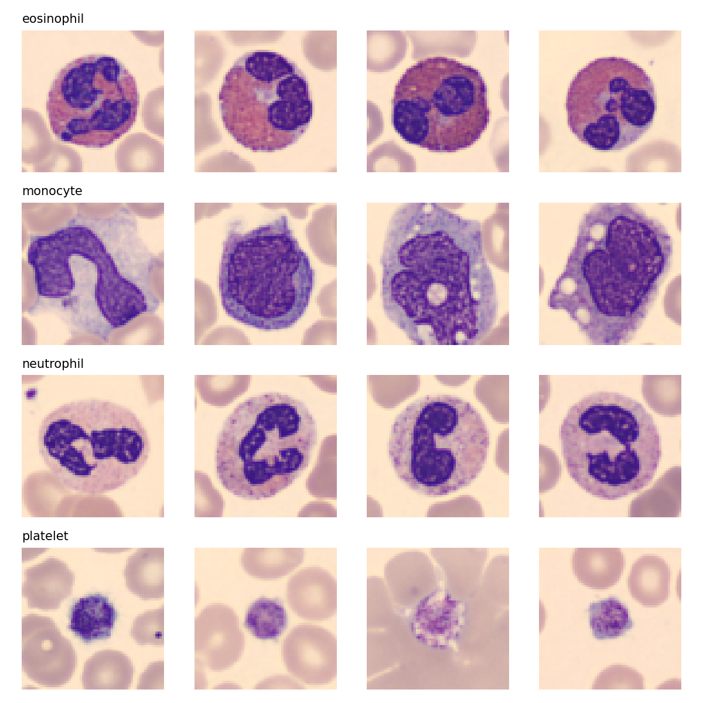
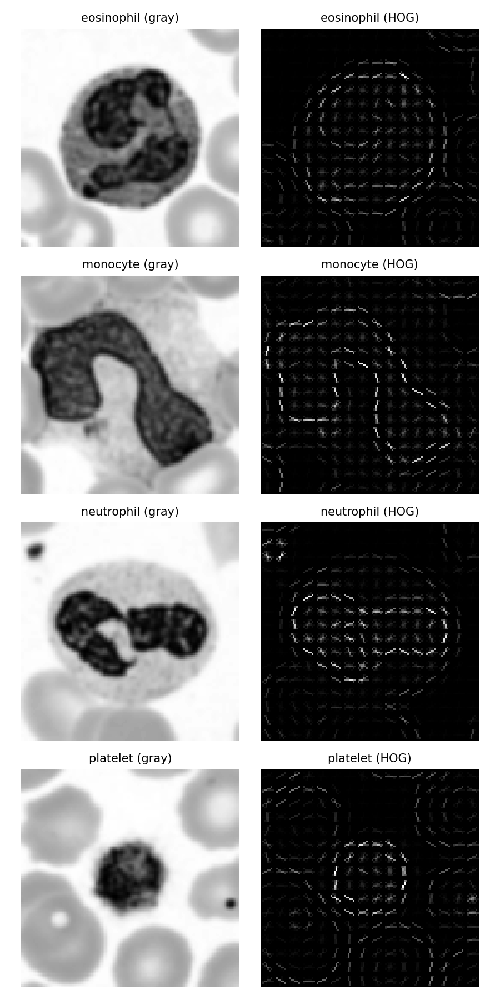
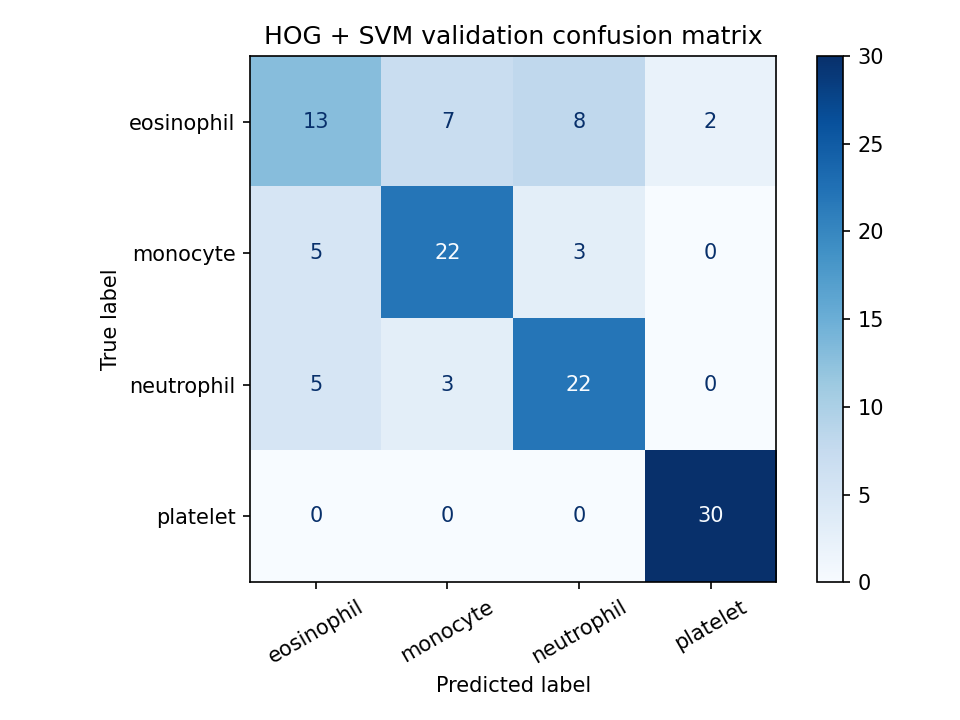
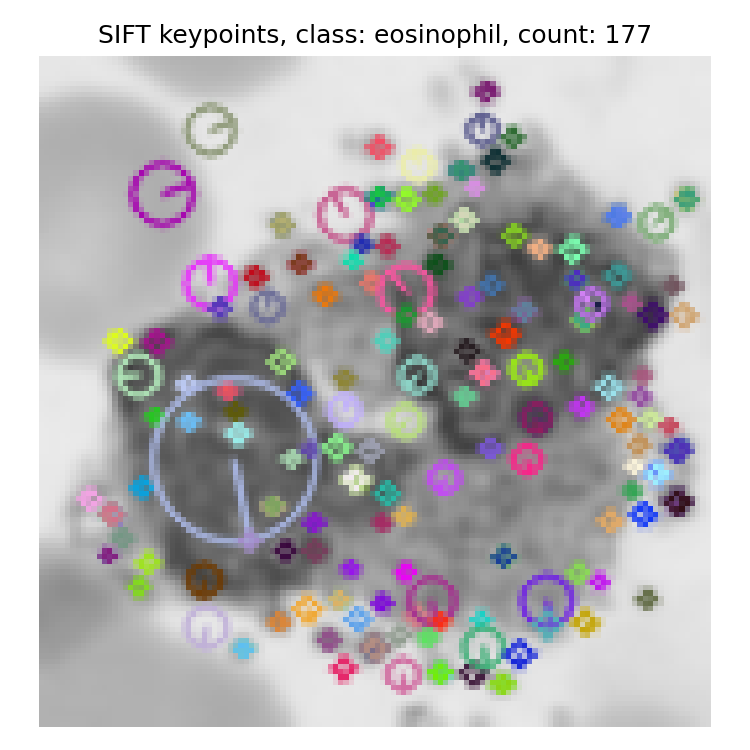
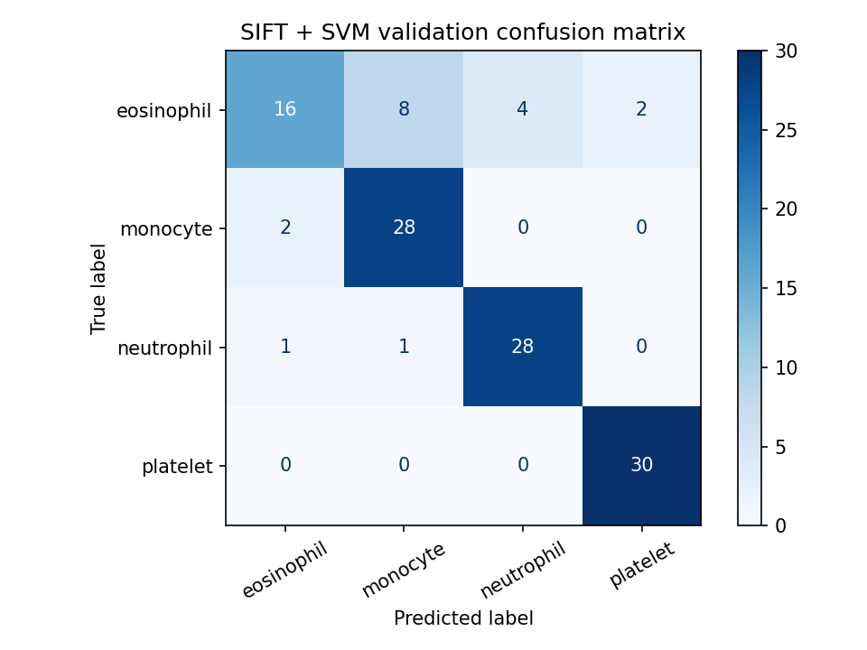
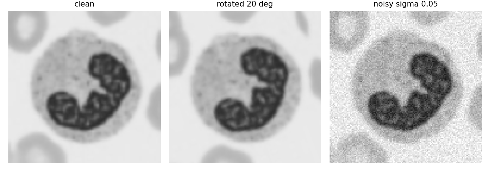

# Lab Mid Exam: HOG vs SIFT on Blood-Cell Images

**Course:** Computer Vision Lab  
**Name:** Osam Sami  
**Registration No:** FA23-BAI-056  
**Dataset:** BloodMNIST (size 64), classes eosinophil, monocyte, neutrophil, platelet  
**Notebook:** FA23-BAI-056_OsamSami_LabMid.ipynb


## Personal Settings

| Setting | Rule | My value |
|---|---|---|
| Random seed | Last two digits of registration number | 56 |
| HOG cell size | Last digit 6 is even | 8 x 8 |
| SIFT grid size | Last digit 6 is between 5 and 9 | 6 x 6 grid (36 keypoints) |

```text
Registration number: FA23-BAI-056
Seed: 56
HOG cell size: 8 x 8
SIFT grid: 6 x 6 -> 36 keypoints
```


## Data Setup

BloodMNIST (64 x 64) is loaded from the direct Zenodo link straight into RAM, the four classes are kept (eosinophil = 1, monocyte = 5, neutrophil = 6, platelet = 7), and a subset of 100 train, 30 validation and 30 test images per class is chosen with seed 56. Images are then converted to grayscale and resized to 128 x 128.

```text
train images: (400, 64, 64, 3) labels: (400,)
    eosinophil : 100
    monocyte : 100
    neutrophil : 100
    platelet : 100
val images: (120, 64, 64, 3) labels: (120,)
    eosinophil : 30
    monocyte : 30
    neutrophil : 30
    platelet : 30
test images: (120, 64, 64, 3) labels: (120,)
    eosinophil : 30
    monocyte : 30
    neutrophil : 30
    platelet : 30
Prepared grayscale shapes: (400, 128, 128) (120, 128, 128) (120, 128, 128) uint8
```

<p align="center">
  <br>
  <em>Figure 1. Four example training images per class (rows: eosinophil, monocyte, neutrophil, platelet).</em>
</p>


## HOG + SVM


### HOG feature length (hand calculation)

Settings: image 128 x 128, cell size 8 x 8, 9 orientations, block = 2 x 2 cells, block stride = 1 cell.

- Cells per side = 128 / 8 = 16, so the image has 16 x 16 cells.
- Blocks per side = 16 - 2 + 1 = 15, so the image has 15 x 15 = 225 blocks.
- Each block holds 2 x 2 cells x 9 orientations = 36 values.
- Total feature length = 225 x 36 = **8100**.

```text
HOG feature length from code: 8100
HOG feature length by hand: 8100
Match: True
```


### HOG pictures (one image per class)

<p align="center">
  <br>
  <em>Figure 2. Grayscale image (left) and its HOG picture (right) for each class.</em>
</p>


### Train HOG + SVM (C chosen on validation set)

```text
   C  val_accuracy
 0.1         0.725
 1.0         0.725
10.0         0.725
Best C for HOG: 0.1
HOG + SVM validation confusion matrix
Validation accuracy: 0.725
Validation macro-F1: 0.7166
Confusion matrix (rows = true, cols = predicted):
[[13  7  8  2]
 [ 5 22  3  0]
 [ 5  3 22  0]
 [ 0  0  0 30]]
```

All three values of C gave the same validation accuracy, so the first (smallest) one, C = 0.1, was kept.

| Metric | HOG + SVM (validation) |
|---|---|
| Best C | 0.1 |
| Accuracy | 0.7250 |
| Macro-F1 | 0.7166 |

<p align="center">
  <br>
  <em>Figure 3. HOG + SVM validation confusion matrix.</em>
</p>


## SIFT + SVM


### Normal SIFT detection

```text
Average keypoints per image: 72.28
Minimum keypoints per image: 10
Maximum keypoints per image: 177
Images with zero keypoints: 0 out of 400
```

<p align="center">
  <br>
  <em>Figure 4. SIFT keypoints drawn on the training image with the most keypoints (eosinophil, 177 keypoints).</em>
</p>

The number of keypoints changes a lot from image to image (from 10 to 177, average 72.28), and no image has zero keypoints.

**Why a different keypoint count is a problem for an SVM:** SVM needs every image to be a feature vector of the same fixed length, but normal SIFT gives a different number of 128-dimensional descriptors for each image (and sometimes none), so the descriptors cannot be joined into one equal-length vector.


### Fixed-grid SIFT features (hand calculation)

Settings: 6 x 6 grid on the 128 x 128 image, keypoint size 32, SIFT descriptor length 128.

- Grid points = 6 x 6 = 36 keypoints.
- Each keypoint gives one 128-dimensional descriptor.
- Total feature length = 36 x 128 = **4608**.

```text
Grid points: 36
SIFT feature length from code: 4608
SIFT feature length by hand: 4608
Match: True
```


### Train SIFT + SVM (C chosen on validation set)

```text
   C  val_accuracy
 0.1        0.8417
 1.0        0.8500
10.0        0.8083
Best C for SIFT: 1
SIFT + SVM validation confusion matrix
Validation accuracy: 0.85
Validation macro-F1: 0.84
Confusion matrix (rows = true, cols = predicted):
[[16  8  4  2]
 [ 2 28  0  0]
 [ 1  1 28  0]
 [ 0  0  0 30]]
```

C = 1 gave the best validation accuracy. Liblinear showed a convergence warning for some values of C; the results above are what the notebook printed.

| Metric | SIFT + SVM (validation) |
|---|---|
| Best C | 1 |
| Accuracy | 0.8500 |
| Macro-F1 | 0.8400 |

<p align="center">
  <br>
  <em>Figure 5. SIFT + SVM validation confusion matrix.</em>
</p>


## Robustness


### Prediction (written before running the test)

- **Rotation:** I think HOG will lose more accuracy. HOG stores gradient orientation histograms in fixed cell positions, so a 20 degree rotation moves edges to different orientation bins and different cells. The grid SIFT descriptors are also not rotation invariant here, but each one covers a larger 32 x 32 patch with smoothing, so I expect a smaller drop.
- **Noise:** I think HOG will lose more accuracy. HOG uses raw pixel gradients, and noise adds many random small gradients. SIFT blurs the patch with a Gaussian window before building the histograms, so it should handle noise better.


### Evaluation on the test set (models frozen)

The rotation (20 degrees) and the Gaussian noise (sigma = 0.05 on the 0 to 1 scale) are applied to the test images before feature extraction. Both models stay frozen and the test set is used only here.

<p align="center">
  <br>
  <em>Figure 6. One test image: clean, rotated by 20 degrees, and with Gaussian noise.</em>
</p>

| Model | Clean accuracy | Rotated accuracy | Noisy accuracy |
|---|---|---|---|
| HOG + SVM | 0.7000 | 0.6917 | 0.4000 |
| SIFT + SVM | 0.7917 | 0.8500 | 0.7917 |

```text
            Clean accuracy  Rotated accuracy  Noisy accuracy  Drop under rotation  Drop under noise
Model
HOG + SVM           0.7000            0.6917          0.4000               0.0083            0.3000
SIFT + SVM          0.7917            0.8500          0.7917              -0.0583            0.0000
```


### Was my prediction correct?

My prediction was correct for noise and, in direction, for rotation. Under noise HOG fell from 0.7000 to 0.4000 (a drop of 0.3000) while SIFT stayed at 0.7917, so HOG lost much more. Under rotation HOG dropped only from 0.7000 to 0.6917 while SIFT actually rose from 0.7917 to 0.8500, so HOG lost more, but the rotation change is small for both models (about 1 and 7 images out of 120), so I cannot claim from this table that 20 degrees really hurt either model.


## Short Answers and AI Log


### Short answers

**(a) Why does HOG use block normalisation?**  
Gradient strength changes with local lighting and contrast, for example because of different stain intensity in blood-cell images. HOG groups cells into overlapping blocks and normalises the histogram of each block, so the features depend on the shape and edge direction and not on how bright or contrasty the image is.

**(b) Why is it wrong to choose C using the test set?**  
If C is picked by looking at test accuracy, the test set has influenced the model, so it is no longer unseen data and the reported accuracy becomes too optimistic. The validation set should be used for choosing C, and the test set should be used once at the end for an honest estimate.


### Most confused classes

```text
HOG + SVM most confused pair: eosinophil and neutrophil | total mistakes between them: 13
    eosinophil predicted as neutrophil : 8
    neutrophil predicted as eosinophil : 5
SIFT + SVM most confused pair: eosinophil and monocyte | total mistakes between them: 10
    eosinophil predicted as monocyte : 8
    monocyte predicted as eosinophil : 2
```

The models confused eosinophil with the other white-cell classes most: HOG mixed up eosinophil and neutrophil (13 mistakes) and SIFT mixed up eosinophil and monocyte (10 mistakes), and eosinophil is the weakest class for both (13 of 30 correct for HOG, 16 of 30 for SIFT). In the colour images (Figure 1) an eosinophil is easy to spot because of its red-pink cytoplasm, but after grayscale conversion this colour difference becomes a similar gray level. Then only the nucleus shape and size remain, and these overlap between eosinophils, neutrophils and monocytes, which makes the classes harder to separate.


### AI log

| Prompt (one line) | What I changed | How I checked |
|---|---|---|
| Make a CPU-only notebook for HOG + SVM vs SIFT + SVM on BloodMNIST using my registration number FA23-BAI-056. | I added my own conditions: load the dataset from a direct link instead of pip, keep it in RAM so it is not read from disk again and again, and use CPU only. I saved all figures in my assets folder myself. | I ran the notebook in Colab and checked the printed settings (seed 56, HOG 8 x 8, grid 6 x 6) against my registration number. I compared the printed feature lengths (8100 and 4608) with my hand calculation and checked that each confusion matrix row adds up to 30. |
| The download cell gives HTTP Error 403, fix it. | I replaced the Zenodo download cell with one that tries other request headers first and then medmnist. | I ran it again in Colab. The dataset loaded and the shapes and class counts printed correctly. |
