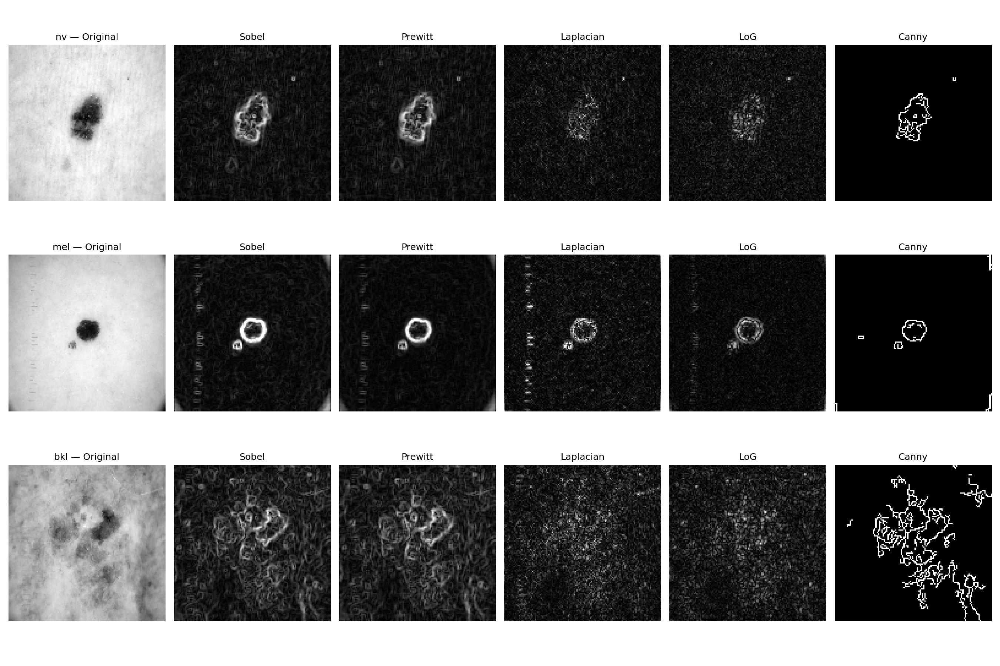
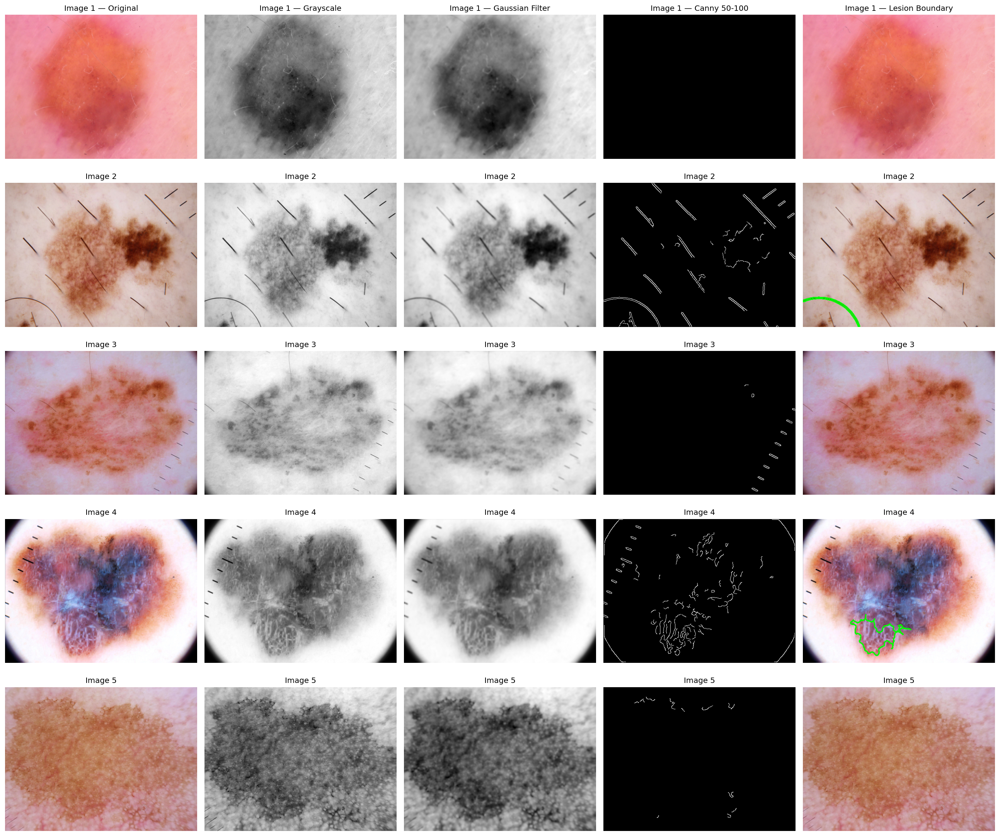
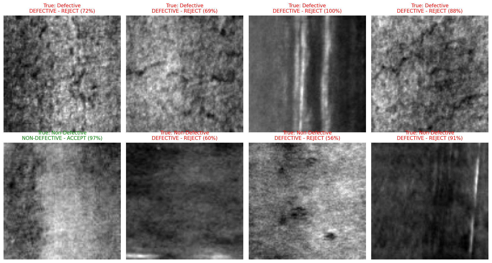
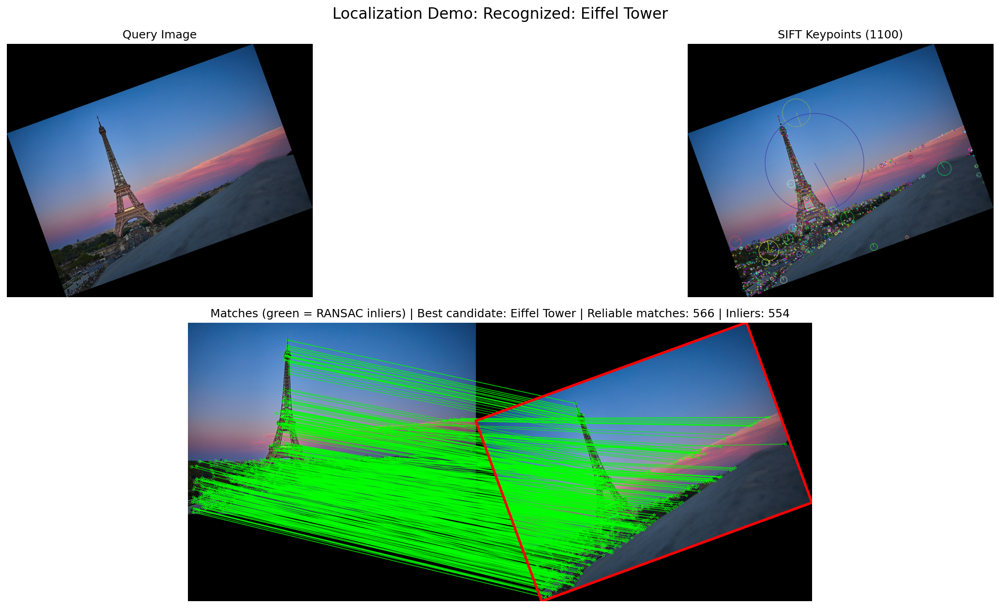
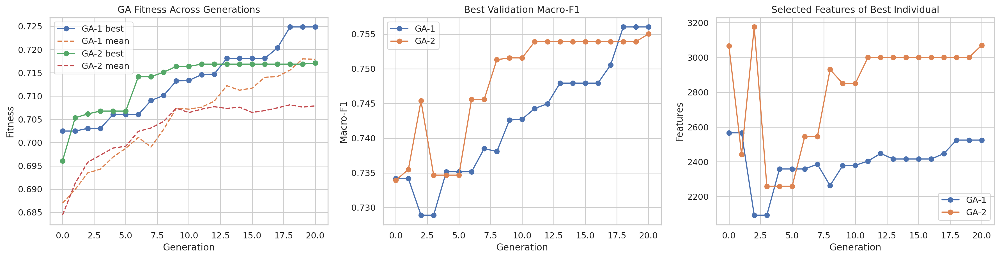
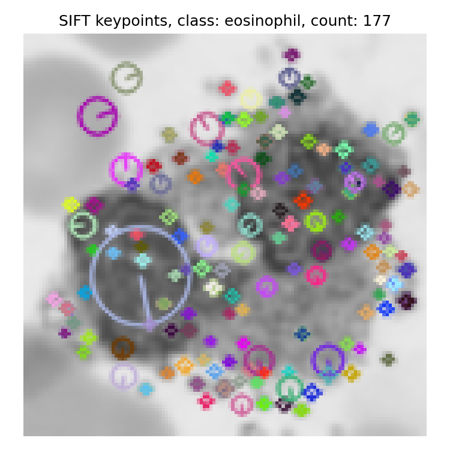
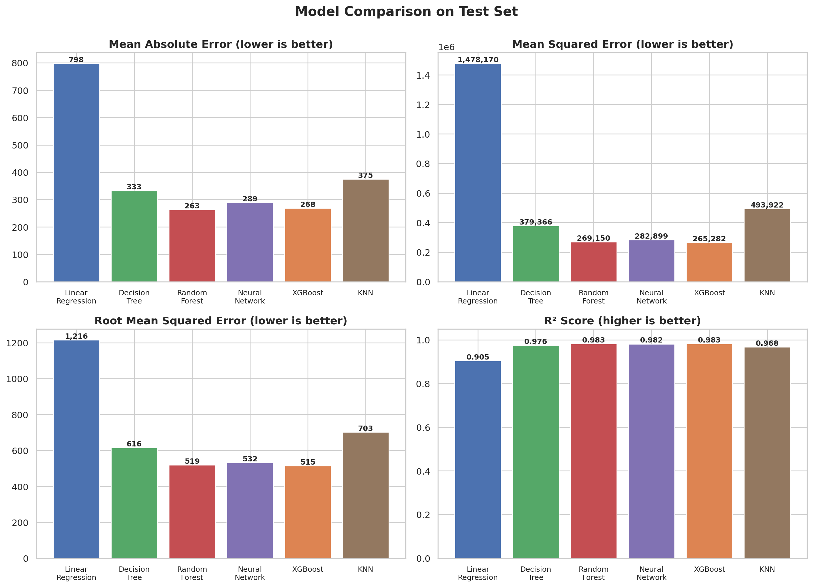

# Computer Vision Lab Series

Production-grade Computer Vision experiments for the Computer Vision lab course, Semester 7, BS Artificial Intelligence, COMSATS University Islamabad, Wah Campus.

The series starts with CNN transfer learning on skin lesion images, moves through image filtering and edge detection, then hand-crafted features (HOG and SIFT), a genetic algorithm for feature selection, a mid exam, a short research paper, and finally a comparison of six regression algorithms. Most labs compare several methods under the same data split and the same metrics, to see what each technique actually does.

## Contents

1. [About this README](#about-this-readme)
2. [Labs at a glance](#labs-at-a-glance)
3. [Lab details](#lab-details)
4. [Live demo](#live-demo)
5. [Repository structure](#repository-structure)
6. [Tech stack](#tech-stack)
7. [Getting started](#getting-started)
8. [Disclaimer](#disclaimer)
9. [Author](#author)

## About this README

| | |
|---|---|
| Purpose | Entry point to the repository: what each lab is about, how it ended, and where the full details are. |
| Depth | Short summaries only. Tasks, tables, figures and answers are in the README inside each lab folder. |
| Folder convention | Each lab is in `LabNN/<Lab-Name>/` with a notebook, a `README.md` and an `assets/` folder holding the figures and CSV tables saved from the actual run. |
| Numbering | There is no Lab 08. The mid exam (`LabMid`) took its place, so the order is Lab07, LabMid, Lab09, Lab10. |
| Type labels | **Lab** = regular lab, **Assignment** = graded lab assignment, **Exam** = lab mid exam, **Paper** = paper-writing task. |
| Source of numbers | Results quoted here are taken from the lab READMEs, which were written from real runs. |
| Last updated | November 2026 |

## Labs at a glance

| Lab | Type | Topic | Dataset | Main methods | Headline result |
|---|---|---|---|---|---|
| [Lab01](Lab01/Skin-Lesion-Classification) | Lab | Skin lesion classification | ISIC, 9 classes | Transfer learning, deep features, classical ML | VGG16 features + RBF-SVM reached 62.71% |
| [Lab02](Lab02/Skin-Lesion-Filtering-Effect) | Lab | Effect of spatial filters on CNNs | ISIC 2019, 5 classes | ResNet50, EfficientNet-B0, DenseNet121 with 5 filters | Sharpening helped slightly, Sobel hurt badly |
| [Lab03](Lab03/Skin-Lesion-Edge-Detection) | Lab | Edge detection and classification | HAM10000 | Sobel, Prewitt, Laplacian, LoG, Canny, SVM, RF, KNN, CNN | Canny was the best detector, edge inputs lowered every model |
| [Lab04](Lab04/Skin-Lesion-Boundary-Detection) | Assignment | Lesion boundary detection | HAM10000 | Gaussian filter, Canny thresholds, contours | Works only on lesions with sharp borders |
| [Lab05](Lab05/HOG-Based_Defect-Detection) | Lab | Industrial defect detection | NEU steel surface | HOG, SVM, QC decision module, webcam demo | 86.61% accuracy, 0.9187 F1 |
| [Lab06](Lab06/Landmark-Recognition-SIFT) | Lab | Landmark recognition | 5 landmark image database | SIFT, ratio test, RANSAC homography | 21 of 25 known landmarks found, unknown one rejected |
| [Lab07](Lab07/GA-HOG-Feature-Selection) | Lab | Genetic algorithm for HOG features | BloodMNIST 128 | HOG, GA feature selection, SVM | 68.8% fewer features, no accuracy gain |
| [LabMid](LabMid/HOG-SIFT_on_Blood-Cell-Image) | Exam | HOG vs SIFT on blood cells | BloodMNIST 64, 4 classes | HOG + SVM, grid SIFT + SVM, rotation and noise test | SIFT held 79% under noise, HOG fell to 40% |
| [Lab09](Lab09/Abstract-Intro-CFC-Paper) | Paper | Abstract and introduction (VisionEvac) | Juelich bottleneck video | YOLOv8, ByteTrack, CPU inference | Paper draft (PDF) |
| [Lab10](Lab10/Regression-Comparison) | Assignment | Six regression algorithms | Diamonds, 53,940 rows | LR, Decision Tree, Random Forest, Neural Net, XGBoost, KNN | XGBoost best, R² 0.9829 |

## Lab details

### Lab01: Skin Lesion Classification
Compares pretrained CNNs on a 9-class skin lesion dataset, then feeds deep features into classical classifiers and compares the compute cost of each network. The best pipeline was VGG16 feature extraction with an RBF-SVM (62.71%). EfficientNet-B0 was the most compact network.

### Lab02: Impact of Spatial Filtering
Trains ResNet50, EfficientNet-B0 and DenseNet121 on the same data with average, Gaussian, median, sharpening and Sobel filters (18 runs in total). Smoothing filters mostly lowered accuracy, sharpening kept it, and Sobel removed too much information.

### Lab03: Edge Detection and Classification
Compares five edge detectors, tests them under noise, studies Canny thresholds, and checks whether edge maps are a good input for SVM, Random Forest, KNN and a small CNN. Canny was the most stable, but replacing the image by its edges made every classifier worse.



### Lab04: Lesion Boundary Detection (assignment)
Grayscale, Gaussian filter, Canny with three threshold pairs, contour detection, and lesion area and perimeter in pixels. Hair, rulers and soft borders break plain Canny, so adaptive thresholds and hair removal would be needed.



### Lab05: HOG-Based Defect Detection
A steel surface inspection system: preprocessing, HOG features, classifier comparison, HOG parameter study, robustness tests, 6-class defect classification and an ACCEPT / REJECT quality-control module. HOG with an SVM reached 86.61% accuracy and ran at about 55 FPS on a simulated stream. A webcam tool is included, see [Live demo](#live-demo).



### Lab06: Landmark Recognition with SIFT
Builds a landmark database, extracts SIFT features, matches a query image and draws the landmark outline using a RANSAC homography. Tested under rotation, scaling, brightness change, a new viewpoint and an unknown landmark. 22 of 26 decisions were correct, and a different viewpoint was the hardest case.



### Lab07: Genetic Algorithm for HOG Features
Adds a genetic algorithm to the HOG pipeline to select features on blood cell images, with a GA settings comparison and bonus tests against random and ANOVA selection. The GA cut the feature count by 68.8% but did not beat the full-feature baseline (macro-F1 78.87% vs 80.23%).



### LabMid: HOG vs SIFT on Blood Cells (exam)
Hand-calculated feature lengths, HOG + SVM and fixed-grid SIFT + SVM on four blood cell classes, followed by a prediction written before testing robustness to rotation and noise. Under Gaussian noise HOG dropped from 70% to 40% while SIFT stayed at 79%.



### Lab09: Abstract and Introduction (paper)
Abstract and introduction of *VisionEvac: CPU-Bound Pedestrian Tracking and Bottleneck Calibration using YOLOv8 and ByteTrack*. [Open the PDF](Lab09/Abstract-Intro-CFC-Paper/vision_evac_cpu_tracker_Paper%20%281%29.pdf).

### Lab10: Six Regression Algorithms (Lab Assignment 03)
Predicts diamond prices with Linear Regression, Decision Tree, Random Forest, Neural Network, XGBoost and KNN on one shared split, with handwritten solutions, error analysis, and overfitting and training time comparison. XGBoost was best (R² 0.9829), Linear Regression was last (R² 0.9048).



## Live demo

Lab05 includes a real-time inspection tool that you launch from the terminal. It opens an OpenCV window, reads the webcam, crops the centre square, extracts HOG features, and shows **PASS** or **DEFECTIVE** with the confidence and the FPS on the video.

```bash
cd Lab05/HOG-Based_Defect-Detection
python realtime_inspection.py
```

Press `q` to quit. The script needs `hog_svm_model.joblib` in the same folder (already included). It only gives meaningful predictions on steel surface images like the training data. A recorded run on a simulated stream is in [`bonus_stream.mp4`](Lab05/HOG-Based_Defect-Detection/assets/bonus_stream.mp4).

## Repository structure

```text
CV-labs/
├── README.md
├── Lab01/Skin-Lesion-Classification/
├── Lab02/Skin-Lesion-Filtering-Effect/
├── Lab03/Skin-Lesion-Edge-Detection/
├── Lab04/Skin-Lesion-Boundary-Detection/
├── Lab05/HOG-Based_Defect-Detection/       includes realtime_inspection.py
├── Lab06/Landmark-Recognition-SIFT/
├── Lab07/GA-HOG-Feature-Selection/
├── LabMid/HOG-SIFT_on_Blood-Cell-Image/
├── Lab09/Abstract-Intro-CFC-Paper/
└── Lab10/Regression-Comparison/

Inside each lab folder:
├── <notebook>.ipynb
├── README.md          tasks, results, tables, answers
└── assets/            figures and CSV tables from the run
```

## Tech stack

| Area | Tools |
|---|---|
| Language and environment | Python, Google Colab |
| Computer vision | OpenCV, scikit-image |
| Machine learning | scikit-learn, XGBoost |
| Deep learning | PyTorch, torchvision |
| Data and plots | NumPy, pandas, SciPy, Matplotlib, Seaborn |
| Datasets and utilities | kagglehub, MedMNIST, joblib |

## Getting started

```bash
git clone https://github.com/Osamsami/CV-labs.git
cd CV-labs
```

1. Open the notebook of the lab you want, preferably in Google Colab. Lab02 needs a GPU runtime, and Lab01 and Lab03 also train CNNs, so a GPU helps there too.
2. Run all cells. Datasets are downloaded inside the notebooks (kagglehub, a direct link, or MedMNIST).
3. The notebooks save their figures and tables next to themselves. The `assets/` folders in this repository are those saved outputs.
4. Each lab README has its own run notes where something extra is needed.

## Disclaimer

The skin lesion and blood cell labs are educational lab work. They are not diagnostic tools and must not be used for medical decisions.

## Author

**Osam Sami** (FA23-BAI-056)  
BS Artificial Intelligence, COMSATS University Islamabad, Wah Campus  
GitHub: [@Osamsami](https://github.com/Osamsami)
